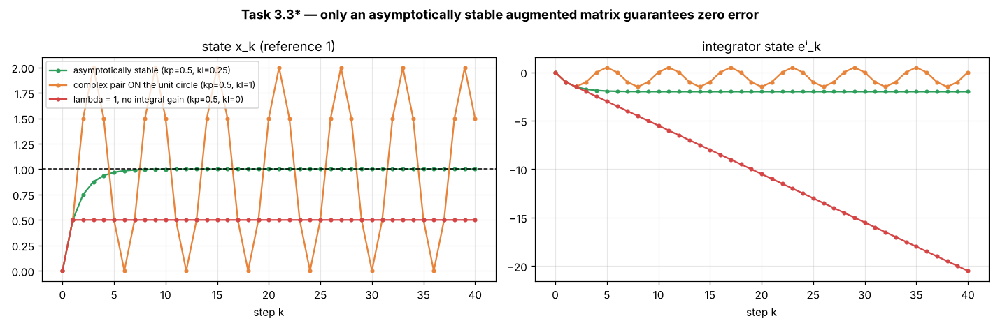
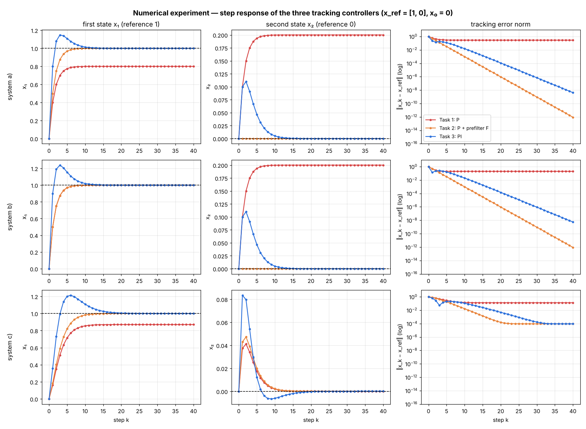
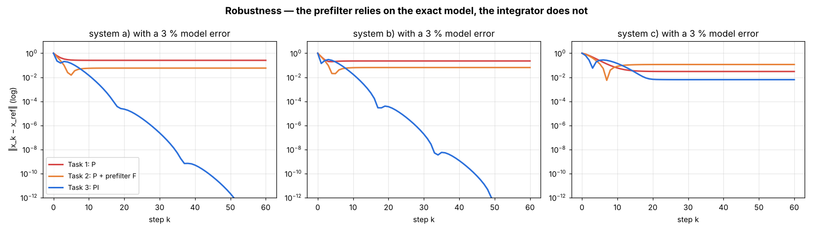
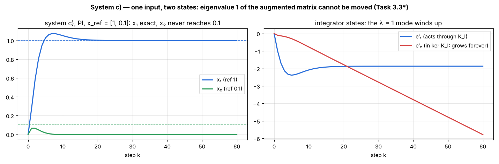

# Exercise 1 — Step-by-Step Solutions

**Course:** Optimization-Based Control Methods (TU Chemnitz, Automatic Control Group, Dr. Adrian Redder)
**Covers:** eigenvalue practice, Tasks 0–3 (all parts) and the numerical experiment
**Reference:** checked against the official *Exercise Solution 1*; where the official solution argues differently, both routes are shown

Every step is written out. Section references like "Concepts §5.4" point to [`01_Concepts.md`](01_Concepts.md), which explains the theory behind each step. The Python scripts in [`python/`](python/) verify every number.

---

## Contents

- [Part A — Eigenvalue practice](#part-a--eigenvalue-practice)
- [Part B — Task 0: Controllable and observable subspaces](#part-b--task-0-controllable-and-observable-subspaces)
- [Part C — Task 1: Tracking error for a state-feedback controller](#part-c--task-1-tracking-error-for-a-state-feedback-controller)
- [Part D — Task 2: State feedback + reference prefilter](#part-d--task-2-state-feedback--reference-prefilter)
- [Part E — Task 3: State feedback + integrator](#part-e--task-3-state-feedback--integrator)
- [Part F — Numerical experiment: controller comparison](#part-f--numerical-experiment-controller-comparison)

---

## Part A — Eigenvalue practice

**Method used throughout (Concepts §2.3):**
(1) form $\lambda I - A$; (2) take $\det(\lambda I - A)$; (3) find the roots; (4) check $\sum\lambda = \operatorname{tr}A$ and $\prod\lambda = \det A$.

**Stability rule (Concepts §4.1):** $x_{k+1} = Ax_k$ is asymptotically stable $\iff$ every eigenvalue has $|\lambda| < 1$.

### Problem 1

$$
A = \begin{bmatrix} 4 & 1 \\ 2 & 3 \end{bmatrix}
$$

**Step 1.** $\lambda I - A = \begin{bmatrix} \lambda - 4 & -1 \\ -2 & \lambda - 3 \end{bmatrix}$.

**Step 2.** $\det(\lambda I - A) = (\lambda - 4)(\lambda - 3) - (-1)(-2) = \lambda^2 - 7\lambda + 12 - 2 = \lambda^2 - 7\lambda + 10$.

*Shortcut check:* $\operatorname{tr}A = 7$ and $\det A = 4\cdot 3 - 1\cdot 2 = 10$ give the same polynomial $\lambda^2 - 7\lambda + 10$.

**Step 3.** Look for two numbers with product $10$ and sum $-7$: these are $-2$ and $-5$. So $(\lambda - 2)(\lambda - 5) = 0$.

$$
\boxed{\lambda = 2,\; 5}
$$

**Step 4.** $2 + 5 = 7 = \operatorname{tr}A$ ✓, $2\cdot 5 = 10 = \det A$ ✓.

**Stable?** No: $|2| > 1$ and $|5| > 1$.

### Problem 2

$$
A = \begin{bmatrix} 3 & 5 \\ 0 & -1 \end{bmatrix}
$$

$\lambda I - A = \begin{bmatrix} \lambda - 3 & -5 \\ 0 & \lambda + 1 \end{bmatrix}$, so
$\det = (\lambda - 3)(\lambda + 1) - (-5)(0) = (\lambda - 3)(\lambda + 1)$.

The $0$ below the diagonal removes the off-diagonal product. This is why **triangular matrices have their diagonal entries as eigenvalues**.

$$
\boxed{\lambda = 3,\; -1}
$$

Check: $3 + (-1) = 2 = \operatorname{tr}A$ ✓, $3\cdot(-1) = -3 = \det A$ ✓.
**Stable?** No: $|3| > 1$. ($|-1| = 1$ is also not strictly inside the unit circle.)

### Problem 3

$$
A = \begin{bmatrix} 0 & 1 \\ -2 & -3 \end{bmatrix}
$$

$\lambda I - A = \begin{bmatrix} \lambda & -1 \\ 2 & \lambda + 3 \end{bmatrix}$, so
$\det = \lambda(\lambda + 3) - (-1)(2) = \lambda^2 + 3\lambda + 2$.

Look for two numbers with product $2$ and sum $3$: these are $1$ and $2$. So $(\lambda + 1)(\lambda + 2) = 0$.

$$
\boxed{\lambda = -1,\; -2}
$$

Check: $-1 - 2 = -3 = \operatorname{tr}A$ ✓, $(-1)(-2) = 2 = \det A$ ✓.

*Note:* in this **controllable canonical form**, the bottom row $[-2,\,-3]$ holds the coefficients of $\lambda^2 + 3\lambda + 2$ with the signs flipped.

**Stable?** No: $|-2| = 2 > 1$ (and $|-1| = 1$ is on the boundary).

### Problem 4

$$
A = \begin{bmatrix} 1 & -2 \\ 2 & 1 \end{bmatrix}
$$

$\lambda I - A = \begin{bmatrix} \lambda - 1 & 2 \\ -2 & \lambda - 1 \end{bmatrix}$, so
$\det = (\lambda - 1)^2 - (2)(-2) = (\lambda - 1)^2 + 4$.

Set it to zero: $(\lambda - 1)^2 = -4 \Rightarrow \lambda - 1 = \pm\sqrt{-4} = \pm 2i$.

(Same result with the formula: $\operatorname{tr}A = 2$, $\det A = 1 + 4 = 5$, $\lambda = \frac{2 \pm \sqrt{4 - 20}}{2} = \frac{2 \pm 4i}{2}$.)

$$
\boxed{\lambda = 1 \pm 2i}
$$

Check: $(1+2i) + (1-2i) = 2$ ✓, $(1+2i)(1-2i) = 1 - 4i^2 = 1 + 4 = 5$ ✓.
Magnitude: $|\lambda| = \sqrt{1^2 + 2^2} = \sqrt 5 \approx 2.24$. Complex eigenvalues mean rotation, and $|\lambda| > 1$ means the state spirals outward.
**Stable?** No.

### Problem 5

$$
A = \begin{bmatrix} 0.5 & 0.2 \\ 0.1 & 0.4 \end{bmatrix}
$$

$\lambda I - A = \begin{bmatrix} \lambda - 0.5 & -0.2 \\ -0.1 & \lambda - 0.4 \end{bmatrix}$, so
$\det = (\lambda - 0.5)(\lambda - 0.4) - (0.2)(0.1) = \lambda^2 - 0.9\lambda + 0.20 - 0.02 = \lambda^2 - 0.9\lambda + 0.18$.

Quadratic formula: discriminant $= 0.9^2 - 4(0.18) = 0.81 - 0.72 = 0.09$, and $\sqrt{0.09} = 0.3$:

$$
\lambda = \frac{0.9 \pm 0.3}{2}
\quad\Rightarrow\quad
\boxed{\lambda = 0.6,\; 0.3}
$$

Check: $0.6 + 0.3 = 0.9$ ✓, $0.6 \cdot 0.3 = 0.18$ ✓.
**Stable?** **Yes**, since $|0.6| < 1$ and $|0.3| < 1$. This is the only stable matrix among the eight problems.

### Problem 6

$$
A = \begin{bmatrix} 1 & 0 & 0 \\ 4 & -2 & 0 \\ 7 & 5 & 0.5 \end{bmatrix}
$$

**Step 1.** Put $\lambda$ on the diagonal and flip every sign. The diagonal entries become $\lambda - 1$, $\lambda - (-2) = \lambda + 2$ and $\lambda - 0.5$:

$$
\lambda I - A = \begin{bmatrix} \lambda - 1 & 0 & 0 \\ -4 & \lambda + 2 & 0 \\ -7 & -5 & \lambda - 0.5 \end{bmatrix}.
$$

**Step 2.** Expand along row 1, $(\lambda - 1,\; 0,\; 0)$. The two zeros remove their terms:

$$
\det(\lambda I - A) = +(\lambda - 1)\det\begin{bmatrix} \lambda + 2 & 0 \\ -5 & \lambda - 0.5 \end{bmatrix} - 0\cdot(\dots) + 0\cdot(\dots).
$$

The $2\times 2$ determinant is $(\lambda + 2)(\lambda - 0.5) - (0)(-5) = (\lambda + 2)(\lambda - 0.5)$. Therefore

$$
\det(\lambda I - A) = (\lambda - 1)(\lambda + 2)(\lambda - 0.5).
$$

**Step 3.** Set each factor to zero:

$$
\boxed{\lambda = 1,\; -2,\; 0.5}
$$

**Step 4.** Sum: $1 - 2 + 0.5 = -0.5 = \operatorname{tr}A$ ✓. Product: $1\cdot(-2)\cdot 0.5 = -1 = \det A$ (the product of the diagonal for a triangular matrix) ✓.

**Why the shortcut works:** the entries below the diagonal ($4, 7, 5$) never contributed, because each time they would appear they are multiplied by a $0$ from above the diagonal.

**Stable?** No. $|-2| = 2 > 1$: that mode doubles in size and flips sign every step. $\lambda = 1$ never shrinks either. Only the $\lambda = 0.5$ mode dies out.

### Problem 7

$$
A = \begin{bmatrix} 2 & 0 & 0 \\ 0 & 1 & 4 \\ 0 & 2 & 3 \end{bmatrix}
$$

$$
\lambda I - A = \begin{bmatrix} \lambda - 2 & 0 & 0 \\ 0 & \lambda - 1 & -4 \\ 0 & -2 & \lambda - 3 \end{bmatrix}.
$$

Expand along row 1:

$$
\det = (\lambda - 2)\big[(\lambda - 1)(\lambda - 3) - (-4)(-2)\big] = (\lambda - 2)\big[\lambda^2 - 4\lambda + 3 - 8\big] = (\lambda - 2)(\lambda^2 - 4\lambda - 5).
$$

Factor: two numbers with product $-5$ and sum $-4$ are $-5$ and $+1$, so $\lambda^2 - 4\lambda - 5 = (\lambda - 5)(\lambda + 1)$.

$$
\boxed{\lambda = 2,\; 5,\; -1}
$$

Check: $2 + 5 - 1 = 6 = 2 + 1 + 3$ ✓. $2\cdot 5\cdot(-1) = -10$, and $\det A = 2\,(1\cdot 3 - 4\cdot 2) = 2(-5) = -10$ ✓.
**Stable?** No.

### Problem 8

$$
A = \begin{bmatrix} 2 & 0 & 1 \\ 0 & 3 & 0 \\ 1 & 0 & 2 \end{bmatrix}
$$

**Step 1.**

$$
\lambda I - A = \begin{bmatrix} \lambda - 2 & 0 & -1 \\ 0 & \lambda - 3 & 0 \\ -1 & 0 & \lambda - 2 \end{bmatrix}.
$$

**Step 2: choose the row.** The middle row $(0,\; \lambda - 3,\; 0)$ has two zeros, so only one term survives.

**Step 3: sign.** By the checkerboard $\begin{bmatrix} + & - & + \\ - & + & - \\ + & - & + \end{bmatrix}$, position $(2,2)$ has sign $+$.

**Step 4: expand.** Delete row 2 and column 2. What remains is $\begin{bmatrix} \lambda - 2 & -1 \\ -1 & \lambda - 2 \end{bmatrix}$:

$$
\det(\lambda I - A) = +(\lambda - 3)\det\begin{bmatrix} \lambda - 2 & -1 \\ -1 & \lambda - 2 \end{bmatrix}.
$$

**Step 5: the $2\times 2$ determinant.** $(\lambda - 2)(\lambda - 2) - (-1)(-1) = (\lambda - 2)^2 - 1$. Careful: $(-1)(-1) = +1$, and it is *subtracted*.

**Step 6: factor.** Use the difference of squares $a^2 - b^2 = (a - b)(a + b)$ with $a = \lambda - 2$, $b = 1$:

$$
(\lambda - 2)^2 - 1 = (\lambda - 3)(\lambda - 1).
$$

(Or expand: $\lambda^2 - 4\lambda + 4 - 1 = \lambda^2 - 4\lambda + 3 = (\lambda - 3)(\lambda - 1)$.)

$$
\det(\lambda I - A) = (\lambda - 3)^2(\lambda - 1)
\quad\Rightarrow\quad
\boxed{\lambda = 1,\; 3,\; 3}
$$

**Step 7: check.** $1 + 3 + 3 = 7 = 2 + 3 + 2$ ✓. $1\cdot 3\cdot 3 = 9$, and $\det A = 3\,(2\cdot 2 - 1\cdot 1) = 9$ (expanding along the middle row) ✓.

**Same result expanding along row 1** (signs $+,-,+$):

$$
\begin{aligned}
\det &= +(\lambda - 2)\det\begin{bmatrix} \lambda - 3 & 0 \\ 0 & \lambda - 2 \end{bmatrix} - 0 + (-1)\det\begin{bmatrix} 0 & \lambda - 3 \\ -1 & 0 \end{bmatrix} \\
&= (\lambda - 2)(\lambda - 3)(\lambda - 2) + (-1)\big[0\cdot 0 - (\lambda - 3)(-1)\big] \\
&= (\lambda - 3)(\lambda - 2)^2 - (\lambda - 3) = (\lambda - 3)\big[(\lambda - 2)^2 - 1\big].
\end{aligned}
$$

It is the same expression, but with more work. That is why choosing the row with the most zeros pays off.

**Stable?** No: $|3| > 1$, so that mode triples every step.

### Summary of Part A

| # | Eigenvalues | Stable? |
|---|---|---|
| 1 | $2,\;5$ | no |
| 2 | $3,\;-1$ | no |
| 3 | $-1,\;-2$ | no |
| 4 | $1 \pm 2i$ ($\lvert\lambda\rvert = \sqrt5$) | no |
| 5 | $0.6,\;0.3$ | **yes** |
| 6 | $1,\;-2,\;0.5$ | no |
| 7 | $2,\;5,\;-1$ | no |
| 8 | $1,\;3,\;3$ | no |

---

## Part B — Task 0: Controllable and observable subspaces

**System:**

$$
x_{k+1} = \underbrace{\begin{bmatrix} 1 & 0 & 0 \\ 0 & 2 & 2 \\ 0 & 1 & 3 \end{bmatrix}}_{A} x_k + \underbrace{\begin{bmatrix} 1 \\ 0 \\ 1 \end{bmatrix}}_{B} u_k,
\qquad
y_k = \underbrace{\begin{bmatrix} 1 & 1 & 1 \end{bmatrix}}_{C} x_k .
$$

Here $n = 3$ states, $m = 1$ input and $p = 1$ output.

### B.0 Preparation: eigenvalues and eigenvectors of $A$

From Concepts §2.7: $\det(\lambda I - A) = (\lambda - 1)^2(\lambda - 4)$, so $\lambda = 1, 1, 4$.

**Eigenvector for $\lambda = 4$:** solve $(4I - A)v = 0$:

$$
\begin{bmatrix} 3 & 0 & 0 \\ 0 & 2 & -2 \\ 0 & -1 & 1 \end{bmatrix} v = 0
\;\Rightarrow\; 3v_1 = 0,\; 2v_2 - 2v_3 = 0
\;\Rightarrow\; v = \begin{bmatrix} 0 \\ 1 \\ 1 \end{bmatrix}.
$$

Check: $A[0,1,1]^\top = [0,\,2+2,\,1+3]^\top = [0,4,4]^\top = 4\cdot[0,1,1]^\top$ ✓.

**Eigenvectors for $\lambda = 1$:** solve $(I - A)v = 0$:

$$
\begin{bmatrix} 0 & 0 & 0 \\ 0 & -1 & -2 \\ 0 & -1 & -2 \end{bmatrix} v = 0
\;\Rightarrow\; -v_2 - 2v_3 = 0
\;\Rightarrow\; v_2 = -2v_3,\; v_1 \text{ free}.
$$

This gives two independent eigenvectors, $[1,0,0]^\top$ and $[0,-2,1]^\top$, so the eigenspace is a plane. In particular, $[1,-2,1]^\top = [1,0,0]^\top + [0,-2,1]^\top$ is also an eigenvector for $\lambda = 1$. It will reappear in B.4.

---

### B.1 Task 0.1 — Is the system reachable? Is it controllable?

**Step 1: build $W_c = [\,B,\; AB,\; A^2B\,]$** (Concepts §5.1, $n = 3$, so we need up to $A^2B$).

$$
B = \begin{bmatrix} 1 \\ 0 \\ 1 \end{bmatrix}.
$$

$$
AB = \begin{bmatrix} 1 & 0 & 0 \\ 0 & 2 & 2 \\ 0 & 1 & 3 \end{bmatrix}\begin{bmatrix} 1 \\ 0 \\ 1 \end{bmatrix}
= \begin{bmatrix} 1\cdot1 + 0 + 0 \\ 0 + 2\cdot 0 + 2\cdot 1 \\ 0 + 1\cdot 0 + 3\cdot 1 \end{bmatrix}
= \begin{bmatrix} 1 \\ 2 \\ 3 \end{bmatrix}.
$$

$$
A^2B = A(AB) = \begin{bmatrix} 1 & 0 & 0 \\ 0 & 2 & 2 \\ 0 & 1 & 3 \end{bmatrix}\begin{bmatrix} 1 \\ 2 \\ 3 \end{bmatrix}
= \begin{bmatrix} 1 \\ 2\cdot2 + 2\cdot3 \\ 1\cdot 2 + 3\cdot 3 \end{bmatrix}
= \begin{bmatrix} 1 \\ 10 \\ 11 \end{bmatrix}.
$$

$$
W_c = \begin{bmatrix} 1 & 1 & 1 \\ 0 & 2 & 10 \\ 1 & 3 & 11 \end{bmatrix}.
$$

**Step 2: rank by row reduction.**

$$
\begin{bmatrix} 1 & 1 & 1 \\ 0 & 2 & 10 \\ 1 & 3 & 11 \end{bmatrix}
\xrightarrow{R_3 - R_1}
\begin{bmatrix} 1 & 1 & 1 \\ 0 & 2 & 10 \\ 0 & 2 & 10 \end{bmatrix}
\xrightarrow{R_3 - R_2}
\begin{bmatrix} 1 & 1 & 1 \\ 0 & 2 & 10 \\ 0 & 0 & 0 \end{bmatrix}
$$

$$
\operatorname{rank}(W_c) = 2 < 3 = n .
$$

Cross-check with the determinant: $\det W_c = 1(2\cdot11 - 10\cdot3) - 1(0\cdot 11 - 10\cdot 1) + 1(0\cdot 3 - 2\cdot 1) = -8 + 10 - 2 = 0$ ✓.

The dependence is explicit: $A^2B = 5\,AB - 4\,B$, since $5[1,2,3] - 4[1,0,1] = [1,10,11]$. This is Cayley–Hamilton at work. With $p(\lambda) = \lambda^3 - 6\lambda^2 + 9\lambda - 4$, the minimal relation for this $B$ happens to come from the factor $(\lambda-1)(\lambda-4) = \lambda^2 - 5\lambda + 4$.

> **Conclusion:** the system is **not reachable** (not fully state controllable).

**Step 3: PBH test — which eigenvalue is the problem?** (Concepts §5.6)

*For $\lambda = 4$:*

$$
\begin{bmatrix} 4I - A & B \end{bmatrix} = \begin{bmatrix} 3 & 0 & 0 & 1 \\ 0 & 2 & -2 & 0 \\ 0 & -1 & 1 & 1 \end{bmatrix}.
$$

Row 1 is the only row with a nonzero first entry, so it is independent of the others. Rows 2 and 3 are not multiples of each other: $R_3 = -\tfrac12 R_2$ would need the last entry to be $0$, but it is $1$. So the rank is $3$, and **$\lambda = 4$ is controllable**.

*For $\lambda = 1$:*

$$
\begin{bmatrix} I - A & B \end{bmatrix} = \begin{bmatrix} 0 & 0 & 0 & 1 \\ 0 & -1 & -2 & 0 \\ 0 & -1 & -2 & 1 \end{bmatrix}.
$$

$R_3 = R_1 + R_2$, so the rank is $2 < 3$. **$\lambda = 1$ is uncontrollable.**

**Step 4: controllable in the sense of Def. 1.2?** Controllability (steering every $x_0$ to the origin) would require every uncontrollable mode to vanish by itself in finite time, which needs eigenvalue $0$. Here the uncontrollable eigenvalue is $\lambda = 1$. That mode neither grows nor decays, and the input cannot influence it.

> **Conclusion:** the system is **not controllable**. It is not even **stabilizable**: the uncontrollable eigenvalue $1$ is not strictly inside the unit circle, so no $K$ can make $A - BK$ asymptotically stable.

**Step 5: intuition — a conserved quantity** (Concepts §5.5). Take $w = [-1,-1,1]^\top$. Then
$w^\top A = -R_1 - R_2 + R_3 = [-1,\,-2+1,\,-2+3] = [-1,-1,1] = 1\cdot w^\top$, and
$w^\top B = -1 - 0 + 1 = 0$. So $z_k := w^\top x_k = x_{3,k} - x_{1,k} - x_{2,k}$ satisfies

$$
z_{k+1} = w^\top A x_k + w^\top B u_k = z_k + 0 .
$$

**The quantity $x_3 - x_1 - x_2$ never changes, whatever input is applied.** A system starting with $z_0 \neq 0$ can never reach the origin, where $z = 0$. That is exactly why it is not controllable.

**Step 6: the same conclusion by direct calculation (the official solution's route).** Try to steer a given $x_0$ to the origin.

- *How many steps can help?* Since $A^2B = 5AB - 4B$, we get $A^3B = 5A^2B - 4AB = 5(5AB - 4B) - 4AB = 21AB - 20B$, and by induction every $A^kB$ lies in $\operatorname{span}\{B, AB\}$. Longer input sequences add no new directions, so it is enough to look at 1 and 2 steps.
- *Two steps:* $x_2 = A^2x_0 + ABu_0 + Bu_1 = 0$ requires
$$
\begin{bmatrix} B & AB \end{bmatrix}\begin{bmatrix} u_1 \\ u_0 \end{bmatrix} = -A^2x_0,
\qquad
A^2 = \begin{bmatrix} 1 & 0 & 0 \\ 0 & 6 & 10 \\ 0 & 5 & 11 \end{bmatrix}.
$$
  The left side always lies in the plane $\operatorname{span}\{B, AB\}$. Because $\det A = 4 \neq 0$, $A^2$ is invertible, so $-A^2x_0$ can be *any* vector of $\mathbb{R}^3$ as $x_0$ varies. Pick an $x_0$ for which it lies off the plane; then the augmented matrix $[\,B\;\;AB\;\;-A^2x_0\,]$ has rank $3 > 2$, and there is no solution.
  *Concrete example:* $x_0 = [0, 0, 1]^\top$ gives $-A^2x_0 = [0, -10, -11]^\top$. Test with the plane equation $x_3 = x_1 + x_2$: $-11 \neq 0 + (-10)$, so it is not in the plane. This $x_0$ cannot be steered to the origin.
- *One step:* $x_1 = Ax_0 + Bu_0 = 0$ needs $-Ax_0 = [u_0, 0, u_0]^\top$, which holds only for special $x_0$.

Hence there are initial states that can never be brought to the origin: **not controllable**, in agreement with Steps 3–5. (Check with Step 5: $x_0 = [0,0,1]$ has $z_0 = 1 - 0 - 0 = 1 \neq 0$.)

**Python check** (`python/task0_reachability_observability.py`):

```text
Eigenvalues of A: [4. 1. 1.]
Reachability matrix R = [B, AB, A^2 B]:
 [[ 1.  1.  1.]
 [ 0.  2. 10.]
 [ 1.  3. 11.]]
rank(R) = 2  (n = 3) -> NOT reachable
PBH test for each distinct eigenvalue:
  lambda = 1: rank[lambda I - A, B] = 2 -> uncontrollable mode
  lambda = 4: rank[lambda I - A, B] = 3 -> controllable mode
```

---

### B.2 Task 0.2 — Reachable subspace and target states

**Step 1: reachable subspace** $= \operatorname{im}(W_c)$ (Concepts §5.4). Since $A^2B$ depends on the first two columns,

$$
\mathcal{R} = \operatorname{span}\left\{ \begin{bmatrix} 1 \\ 0 \\ 1 \end{bmatrix}, \begin{bmatrix} 1 \\ 2 \\ 3 \end{bmatrix} \right\},
$$

which is a plane through the origin (dimension $2$ = rank).

**Step 2: describe the plane with one equation** using the cross product (Concepts §1.6):

$$
\begin{bmatrix} 1 \\ 0 \\ 1 \end{bmatrix} \times \begin{bmatrix} 1 \\ 2 \\ 3 \end{bmatrix}
= \begin{bmatrix} 0\cdot 3 - 1\cdot 2 \\ 1\cdot 1 - 1\cdot 3 \\ 1\cdot 2 - 0\cdot 1 \end{bmatrix}
= \begin{bmatrix} -2 \\ -2 \\ 2 \end{bmatrix} \;\propto\; \begin{bmatrix} -1 \\ -1 \\ 1 \end{bmatrix}.
$$

So the plane is $-x_1 - x_2 + x_3 = 0$:

$$
\boxed{\;\mathcal{R} = \{\,x \in \mathbb{R}^3 : x_3 = x_1 + x_2\,\}\;}
$$

Check: $B$: $1 = 1 + 0$ ✓; $AB$: $3 = 1 + 2$ ✓; $A^2B$: $11 = 1 + 10$ ✓.
This normal vector is exactly the conserved-quantity vector $w$ from B.1 Step 5. Starting from $x_0 = 0$ we have $z = 0$ forever, so we stay in the plane $x_3 - x_1 - x_2 = 0$.

**Step 3: target $x_f^{(1)} = [4, 2, 3]^\top$.**
$x_1 + x_2 = 4 + 2 = 6 \neq 3 = x_3$. The target is not in $\mathcal{R}$.

> **$x_f^{(1)}$ is not reachable** from the origin, with any number of steps or any inputs.

(Rank test: $\operatorname{rank}[W_c \;\; x_f^{(1)}] = 3 \neq 2$.)

**Step 4: target $x_f^{(2)} = [6, 2, 8]^\top$.**
$x_1 + x_2 = 6 + 2 = 8 = x_3$ ✓. **Reachable.**

**Step 5: minimum number of steps.** From $x_0 = 0$, after $N$ steps $x_N = \sum_{j=0}^{N-1}A^{N-1-j}Bu_j$.

*Try $N = 1$:* $x_1 = Bu_0 = [u_0,\; 0,\; u_0]^\top$. The second component is always $0$, but we need $2$. **Impossible.**

*Try $N = 2$:* $x_2 = AB\,u_0 + B\,u_1$:

$$
u_0\begin{bmatrix} 1 \\ 2 \\ 3 \end{bmatrix} + u_1\begin{bmatrix} 1 \\ 0 \\ 1 \end{bmatrix} = \begin{bmatrix} 6 \\ 2 \\ 8 \end{bmatrix}
\quad\Longleftrightarrow\quad
\begin{cases}
u_0 + u_1 = 6 \\
2u_0 = 2 \\
3u_0 + u_1 = 8
\end{cases}
$$

- Row 2: $u_0 = 1$.
- Row 1: $u_1 = 6 - 1 = 5$.
- Row 3 (consistency check): $3\cdot 1 + 5 = 8$ ✓.

> **$x_f^{(2)}$ is reachable in a minimum of $N = 2$ steps, with $u_0 = 1,\; u_1 = 5$.**
> (The solution is unique, because $B$ and $AB$ are independent.)

**Step 6: verify by simulation.**

$$
x_1 = A\cdot 0 + B\cdot 1 = \begin{bmatrix} 1 \\ 0 \\ 1 \end{bmatrix},
\qquad
x_2 = Ax_1 + B\cdot 5 = \begin{bmatrix} 1 \\ 2 \\ 3 \end{bmatrix} + \begin{bmatrix} 5 \\ 0 \\ 5 \end{bmatrix} = \begin{bmatrix} 6 \\ 2 \\ 8 \end{bmatrix} \checkmark
$$

**Python check:**

```text
x_f1 = [4. 2. 3.]: reachable? False
x_f2 = [6. 2. 8.]: reachable? True
  minimum number of steps N = 2, inputs u = [1. 5.]
    x_1 = [1. 0. 1.]
    x_2 = [6. 2. 8.]
```

---

### B.3 Task 0.3 — Is the system observable?

**Step 1: build $W_o = [\,C;\; CA;\; CA^2\,]$** (Concepts §6.1). A row vector times $A$ is a weighted sum of the rows of $A$.

$$
C = \begin{bmatrix} 1 & 1 & 1 \end{bmatrix}.
$$

$$
CA = 1\cdot[1,0,0] + 1\cdot[0,2,2] + 1\cdot[0,1,3] = \begin{bmatrix} 1 & 3 & 5 \end{bmatrix}.
$$

$$
CA^2 = (CA)A = 1\cdot[1,0,0] + 3\cdot[0,2,2] + 5\cdot[0,1,3] = [1,\; 6+5,\; 6+15] = \begin{bmatrix} 1 & 11 & 21 \end{bmatrix}.
$$

$$
W_o = \begin{bmatrix} 1 & 1 & 1 \\ 1 & 3 & 5 \\ 1 & 11 & 21 \end{bmatrix}.
$$

**Step 2: rank.**

$$
\xrightarrow{R_2 - R_1,\;R_3 - R_1}
\begin{bmatrix} 1 & 1 & 1 \\ 0 & 2 & 4 \\ 0 & 10 & 20 \end{bmatrix}
\xrightarrow{R_3 - 5R_2}
\begin{bmatrix} 1 & 1 & 1 \\ 0 & 2 & 4 \\ 0 & 0 & 0 \end{bmatrix}
$$

$$
\operatorname{rank}(W_o) = 2 < 3 .
$$

(Again $CA^2 = 5\,CA - 4\,C$: $5[1,3,5] - 4[1,1,1] = [1,11,21]$ ✓.)

> **Conclusion:** the system is **not observable**.

**Step 3: PBH test.**

*$\lambda = 4$:* $\begin{bmatrix} 4I - A \\ C \end{bmatrix} = \begin{bmatrix} 3 & 0 & 0 \\ 0 & 2 & -2 \\ 0 & -1 & 1 \\ 1 & 1 & 1 \end{bmatrix}$. Rows 1, 2 and 4 give $\det\begin{bmatrix} 3&0&0\\0&2&-2\\1&1&1\end{bmatrix} = 3(2\cdot1 - (-2)\cdot1) = 12 \neq 0$, so the rank is $3$. **Observable mode.**

*$\lambda = 1$:* $\begin{bmatrix} I - A \\ C \end{bmatrix} = \begin{bmatrix} 0 & 0 & 0 \\ 0 & -1 & -2 \\ 0 & -1 & -2 \\ 1 & 1 & 1 \end{bmatrix}$. Rows 2 and 3 are equal and row 1 is zero, so only $[0,-1,-2]$ and $[1,1,1]$ are independent. The rank is $2 < 3$. **Unobservable mode.**

Equivalently, the $\lambda = 1$ eigenvector $v = [1,-2,1]^\top$ has $Cv = 1 - 2 + 1 = 0$: the sensor cannot see it.
The system is also **not detectable**, because the unobservable eigenvalue $1$ is not inside the unit circle.

**Python check:**

```text
Observability matrix O = [C; CA; CA^2]:
 [[ 1.  1.  1.]
 [ 1.  3.  5.]
 [ 1. 11. 21.]]
rank(O) = 2  (n = 3) -> NOT observable
  lambda = 1: rank[lambda I - A; C] = 2 -> unobservable mode
  lambda = 4: rank[lambda I - A; C] = 3 -> observable mode
```

---

### B.4 Task 0.4 — Observable subspace and initial states

**Step 1: unobservable subspace $= \ker(W_o)$.** Solve $W_o v = 0$. Use the two independent rows:

$$
\begin{aligned}
v_1 + v_2 + v_3 &= 0 \qquad (1)\\
v_1 + 3v_2 + 5v_3 &= 0 \qquad (2)
\end{aligned}
$$

$(2) - (1)$: $2v_2 + 4v_3 = 0 \Rightarrow v_2 = -2v_3$.
Into $(1)$: $v_1 = -v_2 - v_3 = 2v_3 - v_3 = v_3$.
With $v_3 = t$: $v = t\,[1, -2, 1]^\top$.

Check with row 3: $1 - 22 + 21 = 0$ ✓.

$$
\boxed{\;\ker(W_o) = \operatorname{span}\{[1,\,-2,\,1]^\top\}\;}\quad\text{(a line, dimension } 3 - 2 = 1\text{)}
$$

**Step 2: observable subspace** $= \ker(W_o)^\perp$ = row space of $W_o$:

$$
\boxed{\;\mathcal{O} = \{\,x : x_1 - 2x_2 + x_3 = 0\,\} = \operatorname{span}\{[1,1,1]^\top,\;[1,3,5]^\top\}\;}
$$

Check: $[1,1,1]$: $1 - 2 + 1 = 0$ ✓; $[1,3,5]$: $1 - 6 + 5 = 0$ ✓.

**Step 3: initial state $x_0^{(1)} = [1, 2, 3]^\top$.**

- Test for membership in $\mathcal{O}$: $1 - 2\cdot2 + 3 = 0$ ✓. So $x_0^{(1)}$ lies in the observable subspace, and its unobservable part is zero.
- Its outputs: $\vec y = W_o x_0^{(1)} = [1+2+3,\; 1+6+15,\; 1+22+63]^\top = [6,\; 22,\; 86]^\top$, which is nonzero.

> **$x_0^{(1)}$ can be observed**: it is the unique state in the observable subspace that produces the outputs $6, 22, 86$.
> *Fine print:* since the system is not observable, any $x_0^{(1)} + c\,[1,-2,1]^\top$ would produce the same outputs. The measurements identify the observable component, and $x_0^{(1)}$ consists only of that component.

*Explicit decomposition (as in the official solution):* write $x_0^{(1)} = m[1,1,1]^\top + n[1,3,5]^\top$. The first two rows give $m + n = 1$ and $m + 3n = 2$, so $n = \tfrac12$ and $m = \tfrac12$. Check row 3: $\tfrac12 + \tfrac52 = 3$ ✓. So
$$
x_0^{(1)} = \tfrac12\begin{bmatrix}1\\1\\1\end{bmatrix} + \tfrac12\begin{bmatrix}1\\3\\5\end{bmatrix} \in \mathcal{O}.
$$

**Step 4: initial state $x_0^{(2)} = [-2, 4, -2]^\top$.**

- $x_0^{(2)} = -2\,[1, -2, 1]^\top$, so it lies entirely in $\ker(W_o)$.
- Outputs: $y_0 = -2 + 4 - 2 = 0$; $y_1 = -2 + 12 - 10 = 0$; $y_2 = -2 + 44 - 42 = 0$.
- Because $[1,-2,1]$ is an eigenvector for $\lambda = 1$, the state never moves ($x_k = x_0^{(2)}$ for all $k$), and $Cx_k = 0$ forever.

> **$x_0^{(2)}$ cannot be observed**: it produces $y_k = 0$ for all $k$, exactly like $x_0 = 0$.

**Python check:**

```text
Basis of UNobservable subspace (kernel of O): [-0.4082  0.8165 -0.4082]   (= multiple of [1,-2,1])
x0_1 = [1. 2. 3.]
  output sequence y_0..y_2 = [ 6. 22. 86.]
  -> lies in the observable subspace: can be observed
x0_2 = [-2.  4. -2.]
  output sequence y_0..y_2 = [0. 0. 0.]
  -> lies entirely in the unobservable subspace: cannot be observed
```

### Task 0 — summary

| Question | Answer |
|---|---|
| Eigenvalues of $A$ | $1, 1, 4$ |
| $\operatorname{rank} W_c$ | $2$ — **not reachable** |
| Uncontrollable mode (PBH) | $\lambda = 1$ — **not controllable**, not stabilizable |
| Reachable subspace | plane $x_3 = x_1 + x_2$ |
| $x_f^{(1)} = [4,2,3]$ | not reachable |
| $x_f^{(2)} = [6,2,8]$ | reachable, min. $N = 2$, $(u_0,u_1) = (1,5)$ |
| $\operatorname{rank} W_o$ | $2$ — **not observable** |
| Unobservable mode (PBH) | $\lambda = 1$ — not detectable |
| Unobservable subspace | $\operatorname{span}\{[1,-2,1]\}$ |
| Observable subspace | plane $x_1 - 2x_2 + x_3 = 0$ |
| $x_0^{(1)} = [1,2,3]$ | observable ($y = 6, 22, 86$) |
| $x_0^{(2)} = [-2,4,-2]$ | not observable ($y \equiv 0$) |

---

## Part C — Task 1: Tracking error for a state-feedback controller

**Setting:** $x_{k+1} = Ax_k + Bu_k$, controller $u_k = -K(x_k - x_{\text{ref}})$ with constant $x_{\text{ref}}$, and $K$ such that $A - BK$ is asymptotically stable.

### C.0 Setting up the closed loop

Substitute the controller into the system:

$$
\begin{aligned}
x_{k+1} &= Ax_k + B\big(-K(x_k - x_{\text{ref}})\big) \\
&= Ax_k - BKx_k + BKx_{\text{ref}} \\
&= \underbrace{(A - BK)}_{=:M}\,x_k + BKx_{\text{ref}} .
\end{aligned}
$$

So the closed loop is $x_{k+1} = Mx_k + c$ with constant $c = BKx_{\text{ref}}$, and by assumption all eigenvalues of $M$ satisfy $|\lambda| < 1$.

---

### C.1 Task 1.1 — $I - (A - BK)$ is invertible and $x_k \to x_\infty$

#### Part (a): invertibility of $I - M$

**Proof by contradiction.**

1. Suppose $I - M$ is **not** invertible.
2. Then there is a vector $v \neq 0$ with $(I - M)v = 0$ (Concepts §1.7).
3. Expand: $v - Mv = 0$, i.e. $Mv = v = 1\cdot v$.
4. So $v$ is an eigenvector of $M$ with eigenvalue $\lambda = 1$.
5. But $M$ is asymptotically stable, so every eigenvalue satisfies $|\lambda| < 1$. Since $|1| = 1$, this is a contradiction.
6. Therefore $I - M = I - (A - BK)$ **is invertible**. $\blacksquare$

> **Remember:** $I - M$ is singular $\iff$ $1$ is an eigenvalue of $M$.

#### Part (b): convergence to $x_\infty = (I - (A - BK))^{-1}BKx_{\text{ref}}$

**Step 1: find the equilibrium.** A limit must be an equilibrium (Concepts §4.3), so set $x_{k+1} = x_k = x_\infty$:

$$
x_\infty = Mx_\infty + BKx_{\text{ref}}
\;\Longrightarrow\;
x_\infty - Mx_\infty = BKx_{\text{ref}}
\;\Longrightarrow\;
(I - M)\,x_\infty = BKx_{\text{ref}} .
$$

By part (a), $I - M$ is invertible, so there is exactly one equilibrium:

$$
x_\infty = (I - M)^{-1}BKx_{\text{ref}} = \big(I - (A - BK)\big)^{-1}BKx_{\text{ref}} .
$$

**Step 2: show that the trajectory actually converges to it** (shift trick, Concepts §4.4). Define $d_k := x_k - x_\infty$:

$$
\begin{aligned}
d_{k+1} &= x_{k+1} - x_\infty \\
&= \big(Mx_k + BKx_{\text{ref}}\big) - \big(Mx_\infty + BKx_{\text{ref}}\big) &&\text{(both satisfy the same update)}\\
&= M(x_k - x_\infty) \\
&= Md_k .
\end{aligned}
$$

By induction, $d_k = M^k d_0$. Since $M$ is asymptotically stable, $M^k \to 0$, hence $d_k \to 0$ for **every** $x_0$:

$$
\lim_{k\to\infty} x_k = x_\infty = \big(I - (A - BK)\big)^{-1}BKx_{\text{ref}} . \qquad\blacksquare
$$

#### Alternative proof (via the lecture's Proposition 1.1)

The closed loop is a system with matrix $M$ and constant "input" $BKx_{\text{ref}}$. By the solution formula,

$$
x_k = M^kx_0 + \sum_{j=0}^{k-1}M^{k-1-j}BKx_{\text{ref}} = M^kx_0 + \Big(\sum_{i=0}^{k-1}M^i\Big)BKx_{\text{ref}} .
$$

As $k\to\infty$: $M^kx_0 \to 0$, and by the geometric series (Concepts §4.2) $\sum_{i=0}^{\infty}M^i = (I - M)^{-1}$. This gives the same $x_\infty$.

---

### C.2 Task 1.2 — Asymptotic tracking error and when it can be zero

#### Step 1: the one-dimensional case (as the hint suggests)

Let $A = a$, $B = b$, $K = k$, all scalars. The closed loop is $x_{k+1} = (a - bk)x_k + bk\,x_{\text{ref}}$.

- **Stability:** $|a - bk| < 1$.
- **Limit:** from C.1, $x_\infty = \dfrac{bk}{1 - (a - bk)}\,x_{\text{ref}} = \dfrac{bk}{1 - a + bk}\,x_{\text{ref}}$.
- **Error:** put both terms over a common denominator:

$$
\begin{aligned}
x_\infty - x_{\text{ref}}
&= \frac{bk}{1 - a + bk}x_{\text{ref}} - \frac{1 - a + bk}{1 - a + bk}x_{\text{ref}} \\
&= \frac{bk - 1 + a - bk}{1 - a + bk}\,x_{\text{ref}} \\
&= \boxed{\frac{a - 1}{1 - a + bk}\,x_{\text{ref}}}
\end{aligned}
$$

**Observation:** the numerator $a - 1$ **does not contain $k$**. Therefore:

- If $a = 1$: the error is $0$ for every stabilizing $k$ ✓.
- If $a \neq 1$ (and $x_{\text{ref}} \neq 0$): the error is **never** zero, whatever $k$ is.

**Can the error at least be made small?** A larger $bk$ makes the denominator larger, but stability restricts it: $|a - bk| < 1 \iff a - 1 < bk < a + 1$. So $1 - a + bk < 2$, and the error is bounded below in size by $\frac{|a - 1|}{2}|x_{\text{ref}}|$. It cannot be made arbitrarily small.

**Numerical example:** $a = 0.5$, $b = 1$. Stability requires $bk \in (-0.5,\, 1.5)$.

| $k$ | $a - bk$ (closed-loop pole) | $x_\infty / x_{\text{ref}} = \frac{bk}{1-a+bk}$ | error $/x_{\text{ref}}$ |
|---|---|---|---|
| $0.5$ | $0$ | $0.5/1.0 = 0.5$ | $-0.5$ |
| $1.0$ | $-0.5$ | $1.0/1.5 \approx 0.667$ | $\approx -0.333$ |
| $1.4$ | $-0.9$ | $1.4/1.9 \approx 0.737$ | $\approx -0.263$ |
| $\to 1.5$ | $\to -1$ (stability limit) | $\to 0.75$ | $\to -0.25$ |

You never get closer than 75 % of the way to the target.

*Remark on the official solution.* It notes that the error "decays to zero as $k \to \infty$". That is true for the formula $\frac{a-1}{1-a+bk}$ on its own, i.e. if the gain could grow without limit (as in continuous time). In discrete time, however, the closed loop is only stable for $bk < a + 1$, so the gain cannot grow beyond that, and the bound above applies. Both statements agree that a larger gain means a smaller error; the discrete-time stability limit just caps how far you can go.

#### Step 2: the general (matrix) case

Use the trick $x_{\text{ref}} = (I - M)^{-1}(I - M)\,x_{\text{ref}}$, which is valid because $I - M$ is invertible:

$$
\begin{aligned}
x_\infty - x_{\text{ref}}
&= (I - M)^{-1}BKx_{\text{ref}} - (I - M)^{-1}(I - M)x_{\text{ref}} \\
&= (I - M)^{-1}\big[BK - (I - M)\big]x_{\text{ref}} \\
&= (I - M)^{-1}\big[BK - I + A - BK\big]x_{\text{ref}} &&(M = A - BK)\\
&= (I - M)^{-1}(A - I)\,x_{\text{ref}} .
\end{aligned}
$$

$$
\boxed{\;x_\infty - x_{\text{ref}} = \big(I - A + BK\big)^{-1}(A - I)\,x_{\text{ref}}\;}
$$

For $n = 1$ this reduces to the scalar formula above. The official solution writes the same result as $x_\infty - x_{\text{ref}} = -\big(I - (A - BK)\big)^{-1}(I - A)x_{\text{ref}}$; the two minus signs cancel.

#### Step 3: when is the error zero?

$(I - A + BK)^{-1}$ is invertible, so it maps only the zero vector to zero. Therefore

$$
x_\infty - x_{\text{ref}} = 0
\iff (A - I)\,x_{\text{ref}} = 0
\iff A\,x_{\text{ref}} = x_{\text{ref}} .
$$

> **Answer to Task 1.2.**
> The asymptotic tracking error is $x_\infty - x_{\text{ref}} = (I - A + BK)^{-1}(A - I)x_{\text{ref}}$.
> It is zero **if and only if $Ax_{\text{ref}} = x_{\text{ref}}$**, i.e. $x_{\text{ref}}$ is already an equilibrium of the *uncontrolled* system ($u = 0$), or equivalently $x_{\text{ref}} \in \ker(A - I)$ (an eigenvector of $A$ for eigenvalue $1$, or $x_{\text{ref}} = 0$).
> - If this holds, **any** stabilizing $K$ achieves $x_\infty = x_{\text{ref}}$.
> - If it does not hold, **no** choice of $K$ achieves zero error. The condition does not depend on $K$ at all.
> - Zero error for **every** reference requires $A = I$ (in 1-D: $a = 1$).

#### Step 4: interpretation (why this happens)

To hold the state at $x_{\text{ref}}$, the input must satisfy $x_{\text{ref}} = Ax_{\text{ref}} + B\bar u$, i.e. $B\bar u = (I - A)x_{\text{ref}}$. This input is nonzero unless $Ax_{\text{ref}} = x_{\text{ref}}$. But at $x = x_{\text{ref}}$ the P-controller outputs $u = -K\cdot 0 = 0$. The controller can only produce input by keeping an error, so the system settles where the error is just large enough to supply the needed input. This is the classic **steady-state error of a P-controller** (Concepts §7.3).

This motivates Task 2 (rescale the reference with a prefilter $F$) and Task 3 (add an integrator, i.e. a PI controller).

#### Step 5: numerical verification (`python/task1_tracking_error.py`)

| Case | Simulated $x_\infty$ | Formula |
|---|---|---|
| 1-D: $a = 0.5,\;b = 1,\;k = 0.5,\;x_{\text{ref}} = 1$ | $0.5$ | $\frac{0.5}{1.0} = 0.5$ ✓ |
| System a) of the numerical experiment, $K = \begin{bmatrix} 0 & 0.2 \\ 0.6 & 0 \end{bmatrix}$, $x_{\text{ref}} = [1,0]^\top$ | $[0.931,\;0.103]$ | $[0.931,\;0.103]$ ✓ |
| Error for the same case | $[-0.069,\;0.103]$ | $(I-A+BK)^{-1}(A-I)x_{\text{ref}} = [-0.069,\;0.103]$ ✓ |

For system a), the closed-loop eigenvalues are $0.445$ and $-0.045$ (stable), but $A[1,0]^\top = [0.9,0.1]^\top \neq [1,0]^\top$, so a steady-state error remains, as the theory predicts.

---

## Part D — Task 2: State feedback + reference prefilter

**Setting:** $x_{k+1} = Ax_k + Bu_k$, controller $u_k = -K(x_k - Fx_{\text{ref}})$ with constant $x_{\text{ref}}$, a prefilter matrix $F$, and $K$ such that $A - BK$ is asymptotically stable. Theory: Concepts §7.4–7.5.

### D.0 Setting up the closed loop

Substitute the controller into the system:

$$
\begin{aligned}
x_{k+1} &= Ax_k + B\big(-K(x_k - Fx_{\text{ref}})\big) \\
&= Ax_k - BKx_k + BKFx_{\text{ref}} \\
&= \underbrace{(A - BK)}_{=:M}\,x_k + BKF\,x_{\text{ref}} .
\end{aligned}
$$

The only difference from Task 1 (Part C.0) is the constant term: $BKFx_{\text{ref}}$ instead of $BKx_{\text{ref}}$.

---

### D.1 Task 2.1 — The limit $x_\infty = (I - (A - BK))^{-1}BKFx_{\text{ref}}$

**Step 1: rename the target.** Define the modified reference

$$
\tilde x_{\text{ref}} := F\,x_{\text{ref}} .
$$

$F$ and $x_{\text{ref}}$ are constant, so $\tilde x_{\text{ref}}$ is a constant vector too. The controller becomes

$$
u_k = -K(x_k - \tilde x_{\text{ref}}),
$$

which is **exactly the Task 1 controller**, only with $\tilde x_{\text{ref}}$ as its reference.

**Step 2: apply Task 1.1.** All assumptions of Task 1.1 hold: same $A$, $B$, $K$, $A - BK$ asymptotically stable, constant reference. So, by Part C.1:

- $I - (A - BK)$ is invertible (because $1$ is not an eigenvalue of the stable matrix $A - BK$), and
- $x_k \to (I - (A - BK))^{-1}BK\,\tilde x_{\text{ref}}$ for every $x_0$.

**Step 3: substitute back** $\tilde x_{\text{ref}} = Fx_{\text{ref}}$:

$$
\boxed{\;x_\infty = \big(I - (A - BK)\big)^{-1}BKF\,x_{\text{ref}}\;} \qquad\blacksquare
$$

*Directly, without Task 1:* the equilibrium of $x_{k+1} = Mx_k + BKFx_{\text{ref}}$ solves $(I - M)x_\infty = BKFx_{\text{ref}}$, and the deviation $d_k = x_k - x_\infty$ satisfies $d_{k+1} = Md_k \to 0$. This is the same shift trick as in C.1.

---

### D.2 Task 2.2 — Tracking error and when it can be zero

#### Step 1: the error formula

As in Task 1, write $x_{\text{ref}} = (I - M)^{-1}(I - M)x_{\text{ref}}$:

$$
\begin{aligned}
x_\infty - x_{\text{ref}}
&= (I - M)^{-1}BKFx_{\text{ref}} - (I - M)^{-1}(I - M)x_{\text{ref}} \\
&= (I - M)^{-1}\big[BKF - I + M\big]x_{\text{ref}} \\
&= (I - M)^{-1}\big[BKF - I + A - BK\big]x_{\text{ref}} \\
&= \big(I - (A - BK)\big)^{-1}\big[(A - BK + BKF) - I\big]x_{\text{ref}} .
\end{aligned}
$$

Equivalently, as in the official solution: $x_\infty - x_{\text{ref}} = \big[(I - (A - BK))^{-1}BKF - I\big]x_{\text{ref}}$.

*Check:* with $F = I$ the bracket is $A - I$, which is the Task 1 result ✓.

#### Step 2: the zero-error condition

$(I - M)^{-1}$ is invertible, so the error is zero exactly when the bracket kills $x_{\text{ref}}$:

$$
x_\infty = x_{\text{ref}}
\iff BKFx_{\text{ref}} = (I - A + BK)x_{\text{ref}}
\iff \boxed{(A - BK + BKF)\,x_{\text{ref}} = x_{\text{ref}}}
$$

**The important difference from Task 1:** the condition now contains $F$, which we are free to choose. In Task 1 the condition $Ax_{\text{ref}} = x_{\text{ref}}$ did not contain anything we could design.

#### Step 3: the one-dimensional case (hint)

With scalars $a, b, k, f$, the condition reads $(a - bk + bkf)x_{\text{ref}} = x_{\text{ref}}$. For $x_{\text{ref}} \neq 0$, divide by $x_{\text{ref}}$:

$$
a - bk + bkf = 1
\;\Longrightarrow\;
bkf = 1 - a + bk
\;\Longrightarrow\;
\boxed{f = \frac{1 - a + bk}{bk} = 1 + \frac{1 - a}{bk}}
$$

Requirements: $b \neq 0$ (the input must affect the state), $k \neq 0$ (otherwise there is no feedback through which $f$ could act), and $|a - bk| < 1$ (stability). Then **zero error for every reference**, for any stabilizing $k$.

*Interpretation:* from Task 1, $x_\infty = \frac{bk}{1 - a + bk}x_{\text{ref}}$, i.e. the closed loop only delivers the fraction $\frac{bk}{1-a+bk}$ of the target. The prefilter multiplies the target by the inverse of that fraction, so the controller **aims higher on purpose** and lands exactly on the target.

*Example* ($a = 0.5,\ b = 1,\ k = 0.5$ from Task 1): $f = \frac{1 - 0.5 + 0.5}{0.5} = 2$. Task 1 settled at $0.5\,x_{\text{ref}}$; aiming at $2x_{\text{ref}}$ gives $x_\infty = 0.5 \cdot 2x_{\text{ref}} = x_{\text{ref}}$ ✓ (`python/task2_prefilter.py`).

#### Step 4: the general (matrix) case

**(i) For one particular reference:** zero error $\iff$ $x_{\text{ref}}$ is an eigenvector of $A - BK + BKF$ with eigenvalue $1$.

**(ii) For every reference at once:** we need $A - BK + BKF = I$. Solve for $F$ step by step:

$$
\begin{aligned}
A - BK + BKF &= I \\
BKF - BK &= I - A \\
BK(F - I) &= I - A \\
F - I &= (BK)^{-1}(I - A) &&\text{(if } BK \text{ is invertible)}\\
F &= (BK)^{-1}(I - A) + I .
\end{aligned}
$$

$$
\boxed{\;F = (BK)^{-1}(I - A) + I\;}
$$

*Verification:* $BKF = BK(BK)^{-1}(I - A) + BK = I - A + BK$, so $A - BK + BKF = A - BK + I - A + BK = I$ ✓.

**When is $BK$ invertible?** $BK$ is $n\times n$, and $\operatorname{rank}(BK) \le \operatorname{rank}B \le m$. Invertibility needs rank $n$, so

$$
m \ge n,\quad \operatorname{rank}B = n,\quad\text{and } K \text{ chosen stabilizing with } BK \text{ invertible.}
$$

**(iii) Fewer inputs than states ($m < n$).** The general formula is impossible. Can a particular $x_{\text{ref}}$ still be reached? The condition $BKFx_{\text{ref}} = (I - A)x_{\text{ref}} + BKx_{\text{ref}}$ has a left side in $\operatorname{im}B$, and $BKx_{\text{ref}} \in \operatorname{im}B$ as well. So we need

$$
(I - A)\,x_{\text{ref}} \in \operatorname{im}B ,
$$

i.e. $x_{\text{ref}}$ must be **holdable** by a constant input (Concepts §7.4). If it is, with $B\bar u = (I - A)x_{\text{ref}}$, then any $F$ with $KFx_{\text{ref}} = \bar u + Kx_{\text{ref}}$ works. If it is not, no prefilter (and no other controller) can reach it.

#### Step 5: interpretation — the prefilter is a feedforward

$$
u_k = -K(x_k - Fx_{\text{ref}}) = -K(x_k - x_{\text{ref}}) + \underbrace{K(F - I)x_{\text{ref}}}_{u_{\text{ff}}} .
$$

With $F$ from Step 4: $Bu_{\text{ff}} = BK(F - I)x_{\text{ref}} = (I - A)x_{\text{ref}}$. That is precisely the input needed to **hold** the state at $x_{\text{ref}}$ (Concepts §7.4). The feedback part is zero at the target, and the feedforward part supplies the holding input.

> **Answer to Task 2.2.**
> $x_\infty - x_{\text{ref}} = (I - (A - BK))^{-1}\big[(A - BK + BKF) - I\big]x_{\text{ref}}$, which is zero iff $(A - BK + BKF)x_{\text{ref}} = x_{\text{ref}}$.
> - **1-D:** choose $f = \dfrac{1 - a + bk}{bk}$ (needs $b \neq 0$, stabilizing $k \neq 0$): zero error for every $x_{\text{ref}}$.
> - **Matrix, all references:** if $\operatorname{rank}B = n$ ($m \ge n$) and $BK$ is invertible: $F = (BK)^{-1}(I - A) + I$.
> - **$m < n$:** possible only for references with $(I - A)x_{\text{ref}} \in \operatorname{im}B$.

---

### D.3 Task 2.3 — Comparing Task 1 b) and Task 2 b)

| | Task 1: $u = -K(x - x_{\text{ref}})$ | Task 2: $u = -K(x - Fx_{\text{ref}})$ |
|---|---|---|
| zero-error condition | $Ax_{\text{ref}} = x_{\text{ref}}$ | $(A - BK + BKF)x_{\text{ref}} = x_{\text{ref}}$ |
| depends on the design? | **no**, $K$ drops out | **yes**, $F$ can be chosen |
| zero error for all $x_{\text{ref}}$ | only if $A = I$ | if $\operatorname{rank}B = n$ (choose $F$ as above) |
| 1-D | only if $a = 1$ | always, with $f = \frac{1-a+bk}{bk}$ |
| input at the target | $0$ | holding input $u_{\text{ff}}$ (feedforward) |

**Discussion.**

1. **Separation of jobs.** In Task 1, the gain $K$ has to do everything, and it cannot fix the steady state. In Task 2, $K$ is chosen for **stability and speed** (the eigenvalues of $A - BK$), and $F$ is chosen afterwards for **steady-state accuracy**. The two design goals are decoupled.
2. **No extra dynamics.** The prefilter adds no states. The transient is governed by the same $A - BK$, and only the target is shifted. In the numerical experiment (Part F) with $A - BK = 0.5I$, the state moves along a straight line, $x_k = (1 - 0.5^k)x_{\text{ref}}$, with no overshoot.
3. **It relies on the model.** $F = (BK)^{-1}(I - A) + I$ contains $A$ and $B$. If the real plant differs, the feedforward is wrong, and nothing in the loop notices.
   *1-D example:* $f = 2$ was designed for $a = 0.5$. If the real plant has $a = 0.55$, then $x_\infty = \frac{bkf}{1 - a + bk}x_{\text{ref}} = \frac{0.5\cdot 2}{1 - 0.55 + 0.5}x_{\text{ref}} = \frac{1}{0.95}x_{\text{ref}} = 1.053\,x_{\text{ref}}$, a 5 % error.
   *Matrix example (Part F):* with a 3 % model error, systems a) and b) get errors of about $0.06$ with the prefilter, compared to $0.23$–$0.26$ without it, and $0$ with the integrator.
4. **It needs enough inputs.** The general formula needs $BK$ invertible ($m \ge n$). For the single-input DC motor (system c), only holdable references can be reached.
5. **Constant disturbances** (e.g. an unknown load) are not compensated either, for the same reason as point 3. This motivates Task 3: an integrator *measures* the remaining error and corrects it.

---

## Part E — Task 3: State feedback + integrator

**Setting:** $u_k = -K_pe_k - K_Ie^i_k = -\begin{bmatrix} K_p & K_I\end{bmatrix}\begin{bmatrix} e_k \\ e^i_k \end{bmatrix}$ with
$e_k := x_k - x_{\text{ref}}$ (constant $x_{\text{ref}}$), $e^i_{k+1} = e^i_k + T_se_k$, $T_s > 0$, and $K_p, K_I \in \mathbb{R}^{m\times n}$. Theory: Concepts §7.6–7.7.

### E.1 Task 3.1 — The augmented state-space model

We want one model with state $z_k = \begin{bmatrix} x_k \\ e^i_k\end{bmatrix} \in \mathbb{R}^{2n}$ and "input" $x_{\text{ref}}$.

**Step 1: write the two update equations on top of each other.**

$$
\begin{bmatrix} x_{k+1} \\ e^i_{k+1} \end{bmatrix}
= \begin{bmatrix} Ax_k + Bu_k \\ e^i_k + T_se_k \end{bmatrix}.
$$

**Step 2: insert the controller** $u_k = -K_pe_k - K_Ie^i_k$ in the first row:

$$
= \begin{bmatrix} Ax_k + B(-K_pe_k - K_Ie^i_k) \\ e^i_k + T_se_k \end{bmatrix}.
$$

**Step 3: insert the error** $e_k = x_k - x_{\text{ref}}$ in both rows:

$$
= \begin{bmatrix} Ax_k - BK_p(x_k - x_{\text{ref}}) - BK_Ie^i_k \\ e^i_k + T_s(x_k - x_{\text{ref}}) \end{bmatrix}.
$$

**Step 4: multiply out and sort each row** into ($x_k$ terms) + ($e^i_k$ terms) + ($x_{\text{ref}}$ terms):

$$
= \begin{bmatrix} (A - BK_p)\,x_k \;-\; BK_I\,e^i_k \;+\; BK_p\,x_{\text{ref}} \\ T_s\,x_k \;+\; e^i_k \;-\; T_s\,x_{\text{ref}} \end{bmatrix}.
$$

**Step 5: read off the block matrices.** The coefficient of $x_k$ in row 2 is $T_sI$, and that of $e^i_k$ is $I$ (identity, size $n$):

$$
\boxed{\;
\begin{bmatrix} x_{k+1} \\ e^i_{k+1} \end{bmatrix}
= \underbrace{\begin{bmatrix} A - BK_p & -BK_I \\ T_sI & I \end{bmatrix}}_{\tilde A\;\in\;\mathbb{R}^{2n\times 2n}}
\begin{bmatrix} x_k \\ e^i_k \end{bmatrix}
+ \underbrace{\begin{bmatrix} BK_p \\ -T_sI \end{bmatrix}}_{\tilde B\;\in\;\mathbb{R}^{2n\times n}} x_{\text{ref}}
\;}
$$

*Check by block multiplication* (Concepts §7.6): row 1 of $\tilde Az_k + \tilde Bx_{\text{ref}}$ is $(A - BK_p)x_k - BK_Ie^i_k + BK_px_{\text{ref}}$ ✓, and row 2 is $T_sx_k + e^i_k - T_sx_{\text{ref}}$ ✓. The dynamics matrix is the one given in the hint.

*Numerical check* (`python/task3_integrator.py`): simulating the controller directly and simulating $z_{k+1} = \tilde Az_k + \tilde Bx_{\text{ref}}$ give the same trajectory, with a maximum difference of $2\cdot10^{-16}$ (rounding).

### E.2 Task 3.2 — Asymptotic stability $\Rightarrow$ zero tracking error

Assume $\tilde A$ is asymptotically stable. The augmented model $z_{k+1} = \tilde Az_k + \tilde Bx_{\text{ref}}$ has exactly the form of Task 1 (a stable matrix plus a constant input), so the Task 1 arguments carry over.

**Step 1: $I - \tilde A$ is invertible.** If not, $\tilde Av = v$ for some $v \neq 0$, so $1$ would be an eigenvalue of $\tilde A$. This contradicts $|\lambda| < 1$.

**Step 2: $z_k$ converges** (Task 1.1 / Proposition 1.1 with $M = \tilde A$ and constant term $\tilde Bx_{\text{ref}}$):

$$
z_k \to \bar z = \begin{bmatrix} x_\infty \\ e^i_\infty \end{bmatrix} = (I - \tilde A)^{-1}\tilde B\,x_{\text{ref}},
$$

and the limit satisfies the equilibrium equation $\bar z = \tilde A\bar z + \tilde Bx_{\text{ref}}$.

**Step 3: write the equilibrium equation block by block.**

$$
\begin{aligned}
\text{row 1:}\quad x_\infty &= (A - BK_p)x_\infty - BK_Ie^i_\infty + BK_px_{\text{ref}}, \\
\text{row 2:}\quad e^i_\infty &= T_sx_\infty + e^i_\infty - T_sx_{\text{ref}} .
\end{aligned}
$$

**Step 4: evaluate the integrator row** (the hint). Subtract $e^i_\infty$ from both sides of row 2:

$$
0 = T_sx_\infty - T_sx_{\text{ref}} = T_s(x_\infty - x_{\text{ref}}).
$$

Since $T_s > 0$, divide by $T_s$:

$$
\boxed{\;x_\infty = x_{\text{ref}}\;} \qquad\blacksquare
$$

Nothing about $A$, $B$, $K_p$ or $K_I$ was used except stability. **The zero error does not depend on knowing the model exactly** (unlike Task 2).

**Step 5 (extra): what the integrator converges to.** Put $x_\infty = x_{\text{ref}}$ into row 1. The $K_p$ terms cancel:

$$
x_{\text{ref}} = Ax_{\text{ref}} - BK_Ie^i_\infty
\quad\Longleftrightarrow\quad
B\,\underbrace{(-K_Ie^i_\infty)}_{u_\infty} = (I - A)\,x_{\text{ref}} .
$$

The final input $u_\infty = -K_Ie^i_\infty$ is exactly the **holding input** (Concepts §7.4). The integrator has *learned* it from the accumulated error, whereas the prefilter of Task 2 *computed* it from the model.
*Example (system a of Part F):* $e^i_\infty = [-0.5,\ 0.5]^\top$, $u_\infty = -\begin{bmatrix} 0 & 0.2 \\ 0.2 & 0 \end{bmatrix}\begin{bmatrix} -0.5 \\ 0.5 \end{bmatrix} = \begin{bmatrix} -0.1 \\ 0.1 \end{bmatrix}$, and $Bu_\infty = [0.1,\ -0.1]^\top = (I - A)x_{\text{ref}}$ ✓.

### E.3* Task 3.3 — When $\tilde A$ is only Lyapunov stable

"Lyapunov stable" means: all $|\lambda| \le 1$, at least one $|\lambda| = 1$, and the trajectories stay bounded. Then $\tilde A^k \not\to 0$, so Steps 1–2 of E.2 fail. There are two ways $|\lambda| = 1$ can happen.

**Case 1: $\lambda = 1$ is an eigenvalue.**

- $I - \tilde A$ is **singular**. The equilibrium equation $(I - \tilde A)\bar z = \tilde Bx_{\text{ref}}$ then has either **no solution** or **infinitely many**, and the geometric series $\sum_k\tilde A^k$ from Task 1 diverges. There is no unique limit to evaluate, so the argument "evaluate the integrator row at the equilibrium" collapses.
- *Example* (1-D plant $a = 0.5$, $b = 1$, $T_s = 1$, $k_p = 0.5$, $k_I = 0$):
  $$
  \tilde A = \begin{bmatrix} a - bk_p & -bk_I \\ T_s & 1 \end{bmatrix} = \begin{bmatrix} 0 & 0 \\ 1 & 1 \end{bmatrix},\qquad \lambda = 0,\ 1 .
  $$
  The integral gain is zero, so this is just the P-controller of Task 1. The state settles at $x_\infty = 0.5$, a 50 % error. Meanwhile, the integrator keeps adding the error: $e^i_{k+1} = e^i_k - 0.5$, reaching $e^i_{40} = -20.5$. **The error remains, and the integrator state grows without bound.** This is integrator windup.
- **This case is unavoidable when $m < n$** (official solution, first bullet): $K_I$ is $m \times n$ with $m < n$, so there is a $w \neq 0$ with $K_Iw = 0$. Then
  $$
  \tilde A\begin{bmatrix} 0 \\ w \end{bmatrix} = \begin{bmatrix} (A - BK_p)\cdot 0 - BK_Iw \\ T_s\cdot 0 + w \end{bmatrix} = \begin{bmatrix} 0 \\ w \end{bmatrix},
  $$
  so $\lambda = 1$ is an eigenvalue **for every choice of $K_p, K_I$**. The integrator component along $w$ never feeds back into the input. It simply keeps summing up its share of the error. (`task3_integrator.py` confirms $\lambda = 1$ for random gains on the single-input DC motor.)

**Case 2: a complex pair $\lambda = e^{\pm i\varphi} \neq 1$.**

- $\tilde A^k$ rotates without shrinking, so the transient never dies out and the tracking error **oscillates forever**.
- *Example* (same plant, $k_p = 0.5$, $k_I = 1$):
  $$
  \tilde A = \begin{bmatrix} 0 & -1 \\ 1 & 1 \end{bmatrix},\qquad
  \det(\lambda I - \tilde A) = \lambda(\lambda - 1) + 1 = \lambda^2 - \lambda + 1 = 0,
  $$
  $$
  \lambda = \frac{1 \pm \sqrt{1 - 4}}{2} = \frac12 \pm i\frac{\sqrt3}{2} = e^{\pm i\pi/3},\qquad |\lambda| = 1 .
  $$
  Simulation from $x_0 = 0$, $e^i_0 = 0$, $x_{\text{ref}} = 1$, using $x_{k+1} = -e^i_k + 0.5$ and $e^i_{k+1} = x_k + e^i_k - 1$:

  | $k$ | 0 | 1 | 2 | 3 | 4 | 5 | 6 | 7 | … |
  |---|---|---|---|---|---|---|---|---|---|
  | $x_k$ | 0 | 0.5 | 1.5 | 2 | 1.5 | 0.5 | 0 | 0.5 | repeats |
  | $e^i_k$ | 0 | −1 | −1.5 | −1 | 0 | 0.5 | 0 | −1 | repeats |

  The state swings between 0 and 2 with period 6 and never settles at 1 (`python/figures/task3_lyapunov_cases.png`).



**Practical implications for the tracking error.**

1. **No guaranteed zero error:** depending on the case, a permanent offset remains (Case 1) or the error oscillates forever (Case 2).
2. **Integrator windup:** in Case 1 an integrator state grows without bound. In a real system the actuator saturates, and when the error finally changes sign the huge accumulated value causes a large overshoot that takes a long time to "unwind".
3. **Fragility:** eigenvalues *on* the unit circle are a boundary case. Any small model error can push them outside, making the loop unstable.
4. **Remedies:** design $K_p, K_I$ so that all eigenvalues of $\tilde A$ lie strictly inside the unit circle, with some margin. With fewer inputs than states, integrate only $m$ output errors that can actually be driven to zero (Part F, system c). Use anti-windup (limit or freeze the integrator when the actuator saturates).

> **Answer to Task 3.3*.** With $\tilde A$ only Lyapunov stable, $\tilde A^k \not\to 0$ and $I - \tilde A$ may be singular. The state need not converge, so $x_\infty = x_{\text{ref}}$ cannot be concluded. In practice the error either persists while the integrator winds up ($\lambda = 1$; always the case when $m < n$), or oscillates without decaying ($\lambda = e^{\pm i\varphi}$).

---

## Part F — Numerical experiment: controller comparison

**Systems** (all with $n = 2$ states), step reference $x_{\text{ref}} = [1, 0]^\top$, and $x_0 = [0, 0]^\top$:

$$
\text{a)}\ A = \begin{bmatrix} 0.9 & 0.5 \\ 0.1 & 0.3 \end{bmatrix},\
\text{b)}\ A = \begin{bmatrix} 1 & 0.5 \\ 0.1 & 0.7 \end{bmatrix},\
B = \begin{bmatrix} 0 & 1 \\ 1 & 0 \end{bmatrix};\qquad
\text{c)}\ A = \begin{bmatrix} 0.9759 & 0.3452 \\ -0.005502 & -0.001944 \end{bmatrix},\
B = \begin{bmatrix} 0.561 \\ 0.1304 \end{bmatrix}.
$$

**Assumption:** the sampling time is not given on the sheet, so we use $T_s = 1$. $T_s$ only appears as $K_IT_s$ (Concepts §7.8), so no conclusion depends on it. For the DC motor (c) the physical meaning of the states is in *system_models.pdf*, which is not available here; we simply call them $x_1$ and $x_2$.

Code: [`python/numerical_experiment.py`](python/numerical_experiment.py). Every number below is printed by it.

### F.1 Question 1 — Single- or multiple-input?

The number of inputs $m$ is the number of **columns of $B$**.

| system | size of $B$ | $m$ | $\operatorname{rank}B$ | type |
|---|---|---|---|---|
| a) | $2\times2$ | 2 | 2 | multiple-input |
| b) | $2\times2$ | 2 | 2 | multiple-input |
| c) | $2\times1$ | 1 | 1 | single-input |

For a) and b), $B$ is a permutation matrix: it swaps the two components, so $B^{-1} = B$ (check: $BB = I$). For c), one input drives both states.

### F.2 Question 2 — Can the controllers of Tasks 1–3 achieve zero tracking error?

**Step 1: eigenvalues of $A$** (2×2 shortcut, Concepts §2.4):

- a) $\operatorname{tr} = 1.2$, $\det = 0.27 - 0.05 = 0.22$: $\lambda = \frac{1.2 \pm\sqrt{1.44 - 0.88}}{2} = \frac{1.2 \pm 0.748}{2} = 0.974,\ 0.226$. Open loop stable.
- b) $\operatorname{tr} = 1.7$, $\det = 0.7 - 0.05 = 0.65$: $\lambda = \frac{1.7 \pm\sqrt{2.89 - 2.6}}{2} = \frac{1.7 \pm 0.539}{2} = 1.119,\ 0.581$. **Open loop unstable.**
- c) $\operatorname{tr} = 0.973956$, $\det = 0.9759(-0.001944) - 0.3452(-0.005502) = -0.0018971 + 0.0018993 = 2.14\cdot10^{-6}$: $\lambda \approx 0.974,\ 0.000002$. One slow mode, and one that dies out almost immediately.

**Step 2: can $K$ be designed at all? (reachability)**

- a), b): $B$ is invertible, so $W_c = [B, AB]$ already has rank 2. Reachable.
- c): $AB = [0.9759\cdot0.561 + 0.3452\cdot0.1304,\ -0.005502\cdot0.561 - 0.001944\cdot0.1304]^\top = [0.5925,\ -0.00334]^\top$, and $\det W_c = 0.561(-0.00334) - 0.5925\cdot0.1304 = -0.0791 \neq 0$. Reachable.

So in all three cases $K$ can place the eigenvalues of $A - BK$ anywhere.

**Step 3: can $x_{\text{ref}} = [1, 0]$ be held at all?** (Concepts §7.4: $(I - A)x_{\text{ref}} \in \operatorname{im}B$?) $(I - A)x_{\text{ref}}$ is the first column of $I - A$:

- a) $[0.1,\ -0.1]^\top$. $B$ is invertible, so yes, with $\bar u = B^{-1}[0.1, -0.1]^\top = [-0.1,\ 0.1]^\top$.
- b) $[0,\ -0.1]^\top$. Yes, with $\bar u = [-0.1,\ 0]^\top$.
- c) $[0.0241,\ 0.005502]^\top$. Is it $\bar u\,[0.561,\ 0.1304]^\top$ for some scalar $\bar u$? Row 1 gives $\bar u = 0.0241/0.561 = 0.04296$; row 2 gives $\bar u = 0.005502/0.1304 = 0.04219$. **Contradiction, so no.**
  All states that *can* be held lie on the line $\bar x = (I - A)^{-1}B\,\bar u$. With $\det(I - A) = 0.0241\cdot1.001944 + 0.3452\cdot0.005502 = 0.026046$:
  $$
  (I - A)^{-1}B = \frac{1}{0.026046}\begin{bmatrix} 1.001944 & 0.3452 \\ -0.005502 & 0.0241 \end{bmatrix}\begin{bmatrix} 0.561 \\ 0.1304 \end{bmatrix}
  = \frac{1}{0.026046}\begin{bmatrix} 0.607105 \\ 0.000056 \end{bmatrix} = \begin{bmatrix} 23.309 \\ 0.00215 \end{bmatrix}.
  $$
  So every holdable state has $x_2 = \frac{0.00215}{23.309}x_1 = 9.23\cdot10^{-5}\,x_1$. The closest holdable state to $[1, 0]$ is $[1,\ 9.23\cdot10^{-5}]$, with $\bar u = 1/23.309 = 0.0429$. **No controller of any kind can reach $[1, 0]$ exactly**, but the unavoidable miss in $x_2$ is only $9\cdot10^{-5}$.

**Step 4: each controller.**

*Task 1 (P):* zero error $\iff Ax_{\text{ref}} = x_{\text{ref}}$:
- a) $A[1,0]^\top = [0.9,\ 0.1]^\top \neq [1, 0]^\top$: **no**.
- b) $A[1,0]^\top = [1,\ 0.1]^\top \neq [1, 0]^\top$: **no** (although the first component matches, which will show in the simulation).
- c) $A[1,0]^\top = [0.9759,\ -0.0055]^\top$: **no**.

*Task 2 (P + prefilter):*
- a), b): $\operatorname{rank}B = 2 = n$, so choose a stabilizing $K$ with $BK$ invertible and $F = (BK)^{-1}(I - A) + I$. **Yes, for every $x_{\text{ref}}$.**
- c): $m = 1 < n = 2$, so $BK$ has rank 1 and the general formula is impossible; zero error would also need $x_{\text{ref}}$ holdable (Step 3). **No, not exactly**: $x_1$ can be made exact, and $x_2$ misses by $9\cdot10^{-5}$.

*Task 3 (PI):* we need $\tilde A$ asymptotically stable, which requires $\operatorname{rank}B = n$ (Concepts §7.7, PBH at $\lambda = 1$).
- a), b): $\operatorname{rank}B = 2$. The script confirms that the augmented pair has $\operatorname{rank}W_c = 4$ of 4. **Yes, for every $x_{\text{ref}}$**, and robust to model errors.
- c): $\operatorname{rank}B = 1$, so $\lambda = 1$ is always an eigenvalue of $\tilde A$ (Task 3.3*). The augmented pair has PBH rank 3 of 4 at $\lambda = 1$. Proposition 1.3 does not apply, and since $[1, 0]$ is not holdable, zero error is impossible anyway. **No.** Integrating only the $x_1$ error still makes $x_1$ exact.

| | Task 1 (P) | Task 2 (P + F) | Task 3 (PI) |
|---|---|---|---|
| a) | no ($Ax_{\text{ref}} \neq x_{\text{ref}}$) | **yes** | **yes** |
| b) | no ($Ax_{\text{ref}} \neq x_{\text{ref}}$) | **yes** | **yes** |
| c) | no | only $x_1$ ($x_2$ off by $9\cdot10^{-5}$) | only $x_1$ ($\lambda = 1$ stuck; $x_{\text{ref}}$ not holdable) |

### F.3 Question 3 — Designing $K$, $F$, $K_p$, $K_I$

#### System a)

**$K$ (method 1 of Concepts §7.8): prescribe $A - BK = D := 0.5I$.** Then $BK = A - 0.5I$, so $K = B^{-1}(A - 0.5I) = B(A - 0.5I)$. Multiplying by $B$ from the left swaps the two rows:

$$
A - 0.5I = \begin{bmatrix} 0.4 & 0.5 \\ 0.1 & -0.2 \end{bmatrix}
\;\Longrightarrow\;
K = \begin{bmatrix} 0.1 & -0.2 \\ 0.4 & 0.5 \end{bmatrix}.
$$

Check: $BK$ swaps the rows back to $\begin{bmatrix} 0.4 & 0.5 \\ 0.1 & -0.2\end{bmatrix}$, so $A - BK = 0.5I$, with eigenvalues $0.5,\ 0.5$. Stable ✓.

**$F = (BK)^{-1}(I - A) + I$.**

- $BK = \begin{bmatrix} 0.4 & 0.5 \\ 0.1 & -0.2 \end{bmatrix}$, $\det(BK) = 0.4(-0.2) - 0.5(0.1) = -0.13$.
- $(BK)^{-1} = \frac{1}{-0.13}\begin{bmatrix} -0.2 & -0.5 \\ -0.1 & 0.4 \end{bmatrix} = \frac{1}{13}\begin{bmatrix} 20 & 50 \\ 10 & -40 \end{bmatrix} \approx \begin{bmatrix} 1.5385 & 3.8462 \\ 0.7692 & -3.0769 \end{bmatrix}$.
- $I - A = \begin{bmatrix} 0.1 & -0.5 \\ -0.1 & 0.7 \end{bmatrix}$.
- $(BK)^{-1}(I - A) = \frac{1}{13}\begin{bmatrix} 20(0.1) + 50(-0.1) & 20(-0.5) + 50(0.7) \\ 10(0.1) - 40(-0.1) & 10(-0.5) - 40(0.7) \end{bmatrix} = \frac{1}{13}\begin{bmatrix} -3 & 25 \\ 5 & -33 \end{bmatrix}$.
- Add $I = \frac{1}{13}\begin{bmatrix} 13 & 0 \\ 0 & 13 \end{bmatrix}$:

$$
F = \frac{1}{13}\begin{bmatrix} 10 & 25 \\ 5 & -20 \end{bmatrix} \approx \begin{bmatrix} 0.7692 & 1.9231 \\ 0.3846 & -1.5385 \end{bmatrix}.
$$

Check: $BKF = (I - A) + BK = I - A + A - 0.5I = 0.5I$, so $A - BK + BKF = 0.5I + 0.5I = I$ ✓.

**$K_p, K_I$ (method 3 of Concepts §7.8).** Target eigenvalues of $\tilde A$: $\lambda_1 = 0.5$, $\lambda_2 = 0.6$ (each twice). With $T_s = 1$:

$$
\alpha = \lambda_1 + \lambda_2 - 1 = 0.1, \qquad \beta = \frac{\lambda_1\lambda_2 - \alpha}{T_s} = 0.3 - 0.1 = 0.2 .
$$

$$
K_p = B^{-1}(A - 0.1I) = B\begin{bmatrix} 0.8 & 0.5 \\ 0.1 & 0.2 \end{bmatrix} = \begin{bmatrix} 0.1 & 0.2 \\ 0.8 & 0.5 \end{bmatrix},
\qquad
K_I = 0.2\,B^{-1} = \begin{bmatrix} 0 & 0.2 \\ 0.2 & 0 \end{bmatrix}.
$$

Check: $A - BK_p = 0.1I$ and $BK_I = 0.2I$, so $\tilde A = \begin{bmatrix} 0.1I & -0.2I \\ I & I \end{bmatrix}$. By the block determinant rule (Concepts §7.6):

$$
\det(\lambda I - \tilde A) = \big((\lambda - 0.1)(\lambda - 1) + 0.2\big)^2 = (\lambda^2 - 1.1\lambda + 0.3)^2 = \big((\lambda - 0.5)(\lambda - 0.6)\big)^2 .
$$

The eigenvalues are $0.5, 0.5, 0.6, 0.6$, all inside the unit circle ✓ (the script prints the same).

#### System b)

Same $B$, same method.

**$K$:** $A - 0.5I = \begin{bmatrix} 0.5 & 0.5 \\ 0.1 & 0.2 \end{bmatrix}$, so $K = \begin{bmatrix} 0.1 & 0.2 \\ 0.5 & 0.5 \end{bmatrix}$, and $A - BK = 0.5I$ ✓. The unstable open-loop eigenvalue $1.119$ has been moved to $0.5$.

**$F$:**

- $BK = \begin{bmatrix} 0.5 & 0.5 \\ 0.1 & 0.2 \end{bmatrix}$, $\det = 0.1 - 0.05 = 0.05$, $(BK)^{-1} = 20\begin{bmatrix} 0.2 & -0.5 \\ -0.1 & 0.5 \end{bmatrix} = \begin{bmatrix} 4 & -10 \\ -2 & 10 \end{bmatrix}$.
- $I - A = \begin{bmatrix} 0 & -0.5 \\ -0.1 & 0.3 \end{bmatrix}$.
- $(BK)^{-1}(I - A) = \begin{bmatrix} 4(0) - 10(-0.1) & 4(-0.5) - 10(0.3) \\ -2(0) + 10(-0.1) & -2(-0.5) + 10(0.3) \end{bmatrix} = \begin{bmatrix} 1 & -5 \\ -1 & 4 \end{bmatrix}$.

$$
F = \begin{bmatrix} 1 & -5 \\ -1 & 4 \end{bmatrix} + I = \begin{bmatrix} 2 & -5 \\ -1 & 5 \end{bmatrix}.
$$

**$K_p, K_I$** ($\alpha = 0.1$, $\beta = 0.2$): $A - 0.1I = \begin{bmatrix} 0.9 & 0.5 \\ 0.1 & 0.6 \end{bmatrix}$, so

$$
K_p = \begin{bmatrix} 0.1 & 0.6 \\ 0.9 & 0.5 \end{bmatrix},\qquad K_I = \begin{bmatrix} 0 & 0.2 \\ 0.2 & 0 \end{bmatrix},\qquad \operatorname{eig}(\tilde A) = 0.5, 0.5, 0.6, 0.6\ ✓.
$$

#### System c) (single input)

**$K$ by coefficient matching** (method 2 of Concepts §7.8), with target eigenvalues $0.5$ and $0.6$, i.e. trace $1.1$ and determinant $0.3$. With $K = [k_1, k_2]$:

$$
\operatorname{tr}(A - BK) = \operatorname{tr}A - b_1k_1 - b_2k_2 = 1.1
\;\Longrightarrow\;
0.561\,k_1 + 0.1304\,k_2 = 0.973956 - 1.1 = -0.126044,
$$

$$
\det(A - BK) = \det A - k_1\underbrace{(b_1a_{22} - b_2a_{12})}_{-0.046105} - k_2\underbrace{(b_2a_{11} - b_1a_{21})}_{0.130344} = 0.3
\;\Longrightarrow\;
-0.046105\,k_1 + 0.130344\,k_2 = 2.14\cdot10^{-6} - 0.3 = -0.299998 .
$$

(Coefficients: $b_1a_{22} - b_2a_{12} = 0.561(-0.001944) - 0.1304(0.3452) = -0.001091 - 0.045014$, and $b_2a_{11} - b_1a_{21} = 0.1304(0.9759) - 0.561(-0.005502) = 0.127257 + 0.003087$.)

Solve with Cramer's rule. The determinant of the coefficient matrix is $0.561(0.130344) - 0.1304(-0.046105) = 0.073123 + 0.006012 = 0.079135$.

$$
k_1 = \frac{(-0.126044)(0.130344) - (0.1304)(-0.299998)}{0.079135} = \frac{-0.016429 + 0.039120}{0.079135} = 0.28673,
$$

$$
k_2 = \frac{(0.561)(-0.299998) - (-0.046105)(-0.126044)}{0.079135} = \frac{-0.168299 - 0.005811}{0.079135} = -2.20016 .
$$

$$
K = \begin{bmatrix} 0.28673 & -2.20016 \end{bmatrix},\qquad
A - BK = \begin{bmatrix} 0.815043 & 1.579492 \\ -0.042892 & 0.284957 \end{bmatrix}.
$$

Check: trace $= 1.1$ ✓, $\det = 0.815043(0.284957) + 1.579492(0.042892) = 0.232252 + 0.067748 = 0.3000$ ✓, so the eigenvalues are $0.5$ and $0.6$. (`scipy.signal.place_poles` returns the same $K$.)

**Task 1 prediction for c):** $x_\infty = (I - M)^{-1}B\,(Kx_{\text{ref}})$ with $Kx_{\text{ref}} = k_1 = 0.28673$. Here $\det(I - M) = (1 - 0.5)(1 - 0.6) = 0.2$, and

$$
g := (I - M)^{-1}B = \frac{1}{0.2}\begin{bmatrix} 0.715043 & 1.579492 \\ -0.042892 & 0.184957 \end{bmatrix}\begin{bmatrix} 0.561 \\ 0.1304 \end{bmatrix} = 5\begin{bmatrix} 0.607105 \\ 0.000056 \end{bmatrix} = \begin{bmatrix} 3.03553 \\ 0.00028 \end{bmatrix},
$$

$$
x_\infty = 0.28673\cdot\begin{bmatrix} 3.03553 \\ 0.00028 \end{bmatrix} = \begin{bmatrix} 0.87039 \\ 0.00008 \end{bmatrix}.
$$

So the P controller only gets 87 % of the way in $x_1$.

**$F$ for c).** Every steady state has the form $x_\infty = g\cdot(KFx_{\text{ref}})$, a multiple of the fixed vector $g$. Its direction cannot be changed; only its length can. Choose $F = fI$ so that the first component is exactly 1:

$$
g_1\cdot f\,k_1 = 1 \;\Longrightarrow\; f = \frac{1}{g_1k_1} = \frac{1}{3.03553\cdot0.28673} = \frac{0.329432}{0.28673} = 1.14892 .
$$

Then $x_\infty = [1,\ 0.00028/3.03553]^\top = [1,\ 9.2\cdot10^{-5}]^\top$, which is the closest holdable state found in F.2 Step 3. For a general reference $[r, 0]$ the same $f$ gives $x_{1,\infty} = r$, because everything is linear.

**$K_p, K_I$ for c).** A full-state integrator cannot work, because $\lambda = 1$ is stuck (F.2). Following the remedy of Task 3.3*, we **integrate only the $x_1$ error**: $K_I = [k_I,\ 0]$. The part that matters is a 3-state system with state $(x, e^i_1)$:

$$
\begin{bmatrix} x_{k+1} \\ e^i_{1,k+1} \end{bmatrix} = \begin{bmatrix} A & 0 \\ T_s[1\ 0] & 1 \end{bmatrix}\begin{bmatrix} x_k \\ e^i_{1,k} \end{bmatrix} + \begin{bmatrix} B \\ 0 \end{bmatrix}u_k + (\text{reference terms}),
$$

whose state feedback $u = -[K_p\ \ k_I][e;\ e^i_1]$ is placed at eigenvalues $0.5, 0.6, 0.7$. This is the same coefficient-matching idea with 3 equations, solved by `place_poles`:

$$
K_p = \begin{bmatrix} 0.64007 & -1.41966 \end{bmatrix},\qquad K_I = \begin{bmatrix} 0.09883 & 0 \end{bmatrix}.
$$

The full $4\times4$ $\tilde A$ then has eigenvalues $0.5,\ 0.6,\ 0.7,\ \mathbf{1}$. The $1$ belongs to $e^i_2$, the direction in $\ker K_I$. That is exactly Task 3.3*.

### F.4 Question 4 — Comparing the tracking errors

Simulation for 40 steps, with $x_{\text{ref}} = [1, 0]^\top$ and $x_0 = 0$:

| system | controller | $x_{40}$ | $\lVert x_{40} - x_{\text{ref}}\rVert$ |
|---|---|---|---|
| a) | Task 1: P | $[0.8,\ 0.2]$ | $0.283$ |
| a) | Task 2: P + F | $[1,\ 0]$ | $9\cdot10^{-13}$ |
| a) | Task 3: PI | $[1,\ 0]$ | $4\cdot10^{-9}$ |
| b) | Task 1: P | $[1.0,\ 0.2]$ | $0.200$ |
| b) | Task 2: P + F | $[1,\ 0]$ | $9\cdot10^{-13}$ |
| b) | Task 3: PI | $[1,\ 0]$ | $6\cdot10^{-9}$ |
| c) | Task 1: P | $[0.87039,\ 0.00008]$ | $0.130$ |
| c) | Task 2: P + F | $[1,\ 0.00009]$ | $9.2\cdot10^{-5}$ |
| c) | Task 3: PI ($x_1$ integrated) | $[1,\ 0.00009]$ | $9.2\cdot10^{-5}$ |

**Hand check of the P results.** With $A - BK = 0.5I$: $x_\infty = (0.5I)^{-1}BKx_{\text{ref}} = 2(A - 0.5I)x_{\text{ref}}$.
- a) $2[0.4,\ 0.1]^\top = [0.8,\ 0.2]^\top$ ✓.
- b) $2[0.5,\ 0.1]^\top = [1.0,\ 0.2]^\top$ ✓. The first component happens to be exact because the first component of $Ax_{\text{ref}}$ equals 1.



**Discussion.**

- **Task 1 (red)** settles quickly but at the wrong place, exactly as predicted by $(I - A + BK)^{-1}(A - I)x_{\text{ref}}$.
- **Task 2 (orange)** is the cleanest response for a) and b). With $A - BK = 0.5I$ and the prefilter, $x_{k+1} = 0.5x_k + 0.5x_{\text{ref}}$, so $x_k = (1 - 0.5^k)x_{\text{ref}}$: a straight path with no overshoot, $x_2$ stays exactly 0, and the error halves every step.
- **Task 3 (blue)** also reaches zero error, but more slowly (its slowest eigenvalue is $0.6$ instead of $0.5$), with overshoot ($x_1$ peaks at about 1.15 in a), 1.24 in b) and 1.21 in c)) and a detour in $x_2$. This is the typical price of integral action: the integrator must first build up the holding input.
- **System c)** confirms F.2: $x_1$ is tracked exactly by Tasks 2 and 3, and $x_2$ settles at $9.2\cdot10^{-5}$, the closest holdable state. No controller can do better.

**Extra 1: robustness to a 3 % model error** (the true $A$ is $1.03\times$ the design model, 60 steps):

| | P | P + F | PI |
|---|---|---|---|
| a) final error | $[-0.148,\ 0.209]$ | $[0.057,\ 0.006]$ | $[0,\ 0]$ |
| b) final error | $[0.071,\ 0.215]$ | $[0.064,\ 0.007]$ | $[0,\ 0]$ |
| c) final error | $[-0.030,\ -0.006]$ | $[0.115,\ -0.007]$ | $[0,\ -0.006]$ |



The prefilter only removes the error for the exact model. With a model error the offset comes back, and in c) it is even worse than the plain P controller. The integrator keeps the error at zero for a) and b), and for $x_1$ in c), because it measures and corrects the error instead of predicting it (Part E.2, Step 5).

**Extra 2: windup in system c).** With an obviously unholdable reference $x_{\text{ref}} = [1,\ 0.1]$, the PI controller still brings $x_1$ to 1, but $x_2$ stays at $9\cdot10^{-5}$. The integrator component $e^i_2$ (in $\ker K_I$, eigenvalue 1) grows by about $-0.1$ every step and reaches $-5.8$ after 60 steps, without bound. This is Task 3.3*, Case 1, in action.



> **Summary of the numerical experiment.**
> - Multi-input systems a), b) ($\operatorname{rank}B = n$): Task 1 leaves an error; Tasks 2 and 3 give zero error. The integrator is slower and overshoots, but it is robust to model errors.
> - Single-input DC motor c): no controller can hold $[1, 0]$ exactly, because it is not an equilibrium for any constant input. Tasks 2 and 3 make $x_1$ exact, and $x_2$ stays $9\cdot10^{-5}$ away. A full-state integrator always keeps an eigenvalue at 1.
