# Exercise 1 — Lab: learning the concepts with a drone and a robot arm

The [Concepts](01_Concepts.md) file explains the theory in symbols. This lab shows the same ideas on two physical systems, using Python plots and animations. Every term from Exercise 1 appears here as something you can **see**:

| Concept | Where you see it |
|---|---|
| eigenvalue, mode, $\lambda^k$ | [Experiment 1](#experiment-1--what-an-eigenvalue-does) |
| stability, unit circle, repeated eigenvalues | [Experiment 2](#experiment-2--the-drone-without-a-controller) |
| controllability, $W_c$, reachable subspace, PBH, minimum steps | [Experiment 3](#experiment-3--controllability-what-can-the-motors-reach) |
| observability, $W_o$, unobservable subspace, PBH | [Experiment 4](#experiment-4--observability-what-can-the-sensors-tell-us) |
| state feedback $u=-Kx$, closed loop $A-BK$, pole placement | [Experiment 5](#experiment-5--state-feedback-moving-the-eigenvalues) |
| Task 1: tracking error $(I-A+BK)^{-1}(A-I)x_{\text{ref}}$ | [Experiment 6](#experiment-6--task-1-live-the-tracking-error) |
| Tasks 2 and 3: prefilter $F$ vs integrator, model mismatch | [Experiment 7](#experiment-7--tasks-2-and-3-live-removing-the-sag) |

---

## How to run it

```bash
cd Exercise-01_Linear-Systems-and-Controllers/lab
pip install numpy scipy matplotlib pillow
python run_all.py                 # runs all 6 experiments, writes figures/ and GIFs
python exp3_controllability.py    # or run a single experiment
python exp5_state_feedback.py --show   # --show opens interactive plot windows
```

Each script prints its numbers (matrices, ranks, eigenvalues) to the terminal and saves its figures into [`lab/figures/`](lab/figures/). The best way to learn from it is to **change a number in a script and re-run it**. Every experiment ends with "Try it yourself" suggestions.

---

## The two systems

### System 1 — a planar quadcopter (drone)

Imagine a drone flying in a vertical plane, seen from the side. It has two rotors. Their **total thrust** lifts it, and the **difference** between them tilts it.

**State** (6 numbers that describe the drone completely at one moment):

$$
x = \begin{bmatrix} y & z & \theta & v_y & v_z & \omega \end{bmatrix}^\top
$$

| | meaning |
|---|---|
| $y$ | horizontal position [m] |
| $z$ | altitude, measured from the hover height [m] |
| $\theta$ | tilt (pitch) angle [rad] |
| $v_y, v_z$ | horizontal and vertical velocity [m/s] |
| $\omega$ | tilt rate [rad/s] |

**Input** (2 numbers the controller commands): $u = [\,\delta F,\ \tau\,]^\top$. Here $\delta F$ is the extra thrust above what's needed to hover, and $\tau$ is the torque from the difference between the two rotor thrusts.

**Physics, linearised about hover.** The full equations contain $\sin\theta$ and $\cos\theta$. For small tilts, $\sin\theta \approx \theta$ and $\cos\theta \approx 1$, and gravity is exactly cancelled by the hover thrust. With mass $m = 0.5$ kg, inertia $J = 0.004$ kg m² and a small air drag $c = 0.2$ 1/s:

$$
\ddot y = -g\,\theta - c\,\dot y \qquad\text{(tilting the thrust vector pushes sideways)}
$$
$$
\ddot z = \frac{\delta F}{m} - c\,\dot z \qquad\text{(extra thrust lifts)}
$$
$$
\ddot\theta = \frac{\tau}{J} \qquad\text{(torque spins the drone)}
$$

These are linear, so they can be written as $\dot x = A_c x + B_c u$ (continuous time).

**From continuous to discrete time.** A digital controller measures and acts every $T_s = 0.1$ s and holds the input constant in between (a *zero-order hold*). The exact discrete model is then

$$
x_{k+1} = A x_k + B u_k, \qquad A = e^{A_c T_s},\quad B = \int_0^{T_s} e^{A_c s}\,ds\;B_c ,
$$

which is the model class of Exercise 1. The function `c2d` in [`lab_common.py`](lab/lab_common.py) computes this. A useful rule that follows from it:

$$
\boxed{\lambda_{\text{discrete}} = e^{\lambda_{\text{continuous}}\,T_s}}
$$

So the continuous-time stability condition ($\operatorname{Re}\lambda_c < 0$) becomes the discrete-time one ($|\lambda| < 1$), and a pure integrator ($\lambda_c = 0$) becomes $\lambda = e^0 = 1$.

### System 2 — a robot arm joint

This is a single link of length $l = 0.5$ m and mass $m = 1$ kg, hanging under gravity and driven by a motor torque $\tau$. It is linearised about the hanging-down position, with $T_s = 0.05$ s:

$$
\ddot\theta = -\frac{g}{l}\theta - \frac{b}{ml^2}\dot\theta + \frac{\tau}{ml^2},
\qquad x = [\theta,\ \omega]^\top,\quad u = \tau .
$$

The important physical fact for Task 1: **gravity always pulls the arm back down**. Holding it at any angle other than $0$ requires a constant torque.

---

## Experiment 1 — What an eigenvalue does

**Script:** [`lab/exp1_eigenvalues_and_modes.py`](lab/exp1_eigenvalues_and_modes.py) · **Concepts:** Concepts §2, §3.3

Along an eigenvector, the system $x_{k+1} = Ax_k$ simply multiplies the state by $\lambda$ every step, so $x_k = \lambda^k x_0$. This experiment places eight eigenvalues around the unit circle and plots $\lambda^k$ for each.

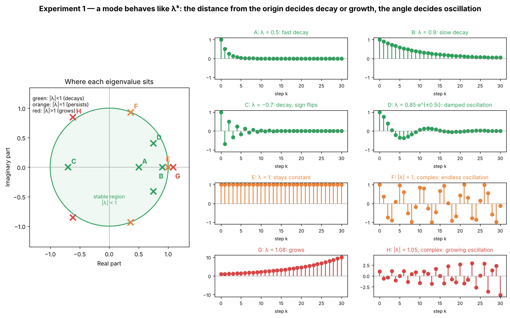

**What to notice**

- **Distance from the origin, $|\lambda|$, decides growth.** Inside the circle (A, B, C, D) the sequence dies out; on the circle (E, F) it keeps the same size forever; outside (G, H) it grows. After 30 steps: $0.5^{30} \approx 10^{-9}$, $0.9^{30} \approx 0.04$, $1^{30} = 1$, $1.08^{30} \approx 10$.
- **Closer to the origin = faster.** Compare A ($\lambda = 0.5$, gone after about 5 steps) with B ($\lambda = 0.9$, still visible after 30 steps).
- **The angle decides oscillation.** A negative real $\lambda$ (C) flips sign every step. A complex pair (D, F, H) rotates, which shows up as oscillation. The larger the angle, the faster the oscillation.

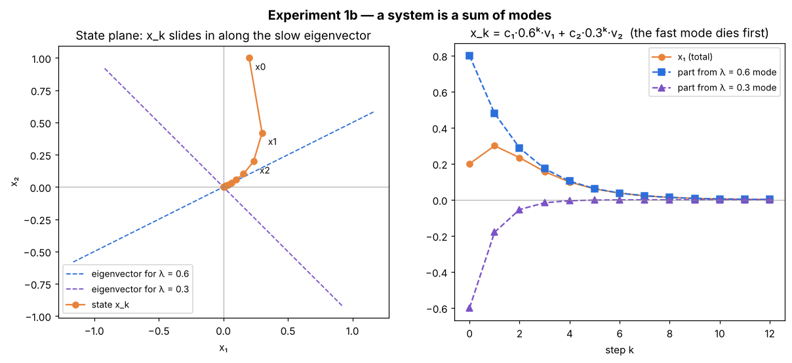

**A whole system is a sum of modes.** For the matrix of practice problem 5 (eigenvalues $0.6$ and $0.3$), write the initial state as $x_0 = c_1 v_1 + c_2 v_2$. Then

$$
x_k = c_1\,0.6^k\,v_1 + c_2\,0.3^k\,v_2 .
$$

On the right, the purple ($\lambda = 0.3$) part dies first. On the left, after a couple of steps the state slides into the origin **along the slow eigenvector**, because only the slowest mode is left. In general, **the eigenvalue with the largest $|\lambda|$ sets how fast the whole system settles.**

**Try it yourself:** in the script, change case B to $\lambda = 0.99$ or $\lambda = -0.99$. How many steps until it is below $0.1$? (Answer: $k = \ln 0.1 / \ln 0.99 \approx 229$.)

---

## Experiment 2 — The drone without a controller

**Script:** [`lab/exp2_drone_open_loop.py`](lab/exp2_drone_open_loop.py) · **Concepts:** Concepts §2.6, §3.3, §4.1

Fly the drone with **zero input** (exact hover thrust, no torque) from three slightly disturbed starts.

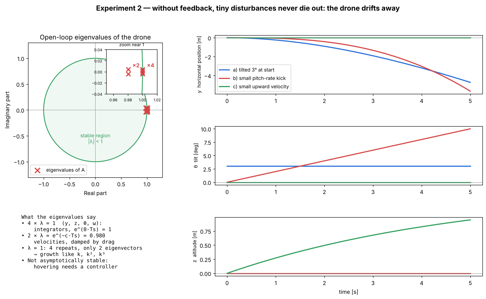

**The eigenvalues** (printed by the script):

```text
Continuous-time eigenvalues  : [-0.2 -0.2  0.   0.   0.   0. ]
Discrete-time eigenvalues    : [0.9802 0.9802 1.     1.     1.     1.    ]
Check lambda_d = e^{lambda_c Ts}: [0.9802 0.9802 1.     1.     1.     1.    ]
lambda = 1: algebraic multiplicity 4, geometric multiplicity 2
```

- **Four eigenvalues at exactly 1.** Position $y$, altitude $z$, tilt $\theta$ and tilt rate $\omega$ are all *integrators*: nothing pulls them back. Continuous $\lambda_c = 0$ becomes $e^{0 \cdot T_s} = 1$.
- **Two eigenvalues at $e^{-cT_s} = 0.980$.** Air drag slowly damps the two velocities.
- **$\lambda = 1$ repeats 4 times but has only 2 eigenvectors.** When an eigenvalue has fewer eigenvectors than repeats, the matrix is not diagonalisable (it has a *Jordan block*), and the state can grow like $k$, $k^2$, $k^3$ even though $|\lambda| = 1$. This is why the stability condition says a repeated eigenvalue on the unit circle needs enough eigenvectors (Concepts §4.1).

**What the three flights show**

| start | what happens | why |
|---|---|---|
| a) tilted 3° | tilt stays 3°, the drone accelerates sideways: $y = -4.7$ m after 5 s | tilt is an integrator (stays), and it keeps pushing $v_y$ |
| b) small tilt-rate kick | tilt grows linearly to 10°, $y$ runs away even faster ($-5.7$ m) | the chain $\omega \to \theta \to v_y \to y$: a constant $\omega$ makes $\theta \sim k$ and $y \sim k^3$ |
| c) small upward velocity | rises and *stays* at the new height (+0.95 m) | drag stops $v_z$ ($\lambda = 0.98$), but nothing brings $z$ back ($\lambda = 1$) |

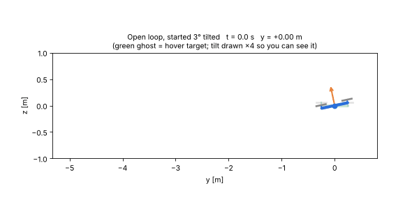

**Conclusion:** not all $|\lambda| < 1$, so the drone is **not asymptotically stable**. A tiny disturbance never dies out, and some grow without bound. A real drone cannot hover without feedback.

**Try it yourself:** set `drag=0` in `planar_quadcopter()` and re-run. All six eigenvalues become exactly 1. Which flight changes the most?

---

## Experiment 3 — Controllability: what can the motors reach?

**Script:** [`lab/exp3_controllability.py`](lab/exp3_controllability.py) · **Concepts:** Concepts §5 · Solutions Task 0.1–0.2

We compare three drones: a **healthy** one; one whose **torque control failed** (only total thrust $\delta F$ works); and one whose **thrust control failed** (only torque $\tau$ works). Their input matrices are $B$, the first column of $B$, and the second column of $B$.

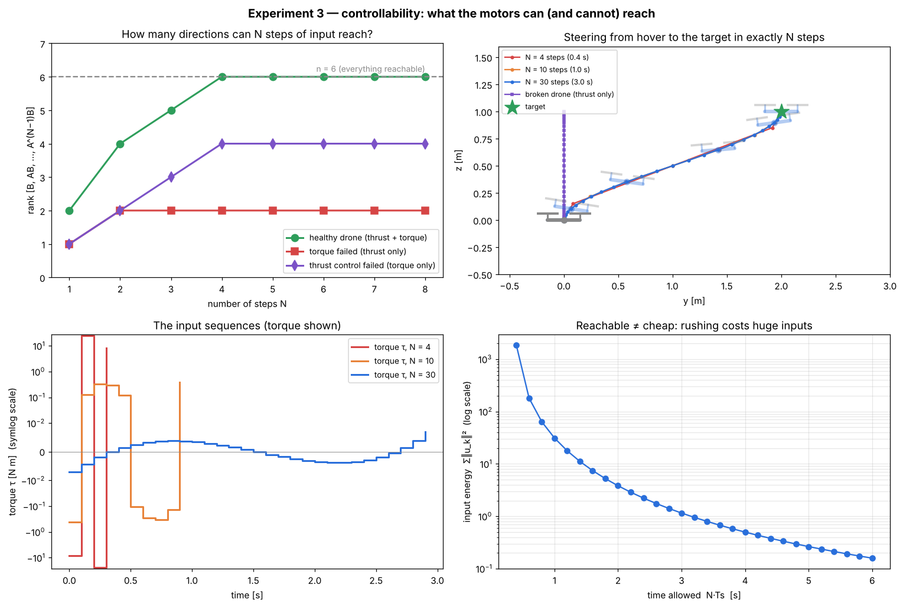

**Top-left: rank of $W_c(N) = [B,\ AB,\ \dots,\ A^{N-1}B]$ as the number of steps $N$ grows.** The rank is the number of independent directions that $N$ steps of input can push the state in.

```text
healthy drone (thrust + torque):     rank W_c = 6 of 6   -> reachable
torque failed (thrust only):         rank W_c = 2 of 6   reachable subspace: z, vz
thrust control failed (torque only): rank W_c = 4 of 6   reachable subspace: y, theta, vy, omega
```

- **Healthy:** the rank climbs $2 \to 4 \to 5 \to 6$ and is full after 4 steps. The system is **reachable**, so every state can be reached.
- The rank **stops growing** once it stalls. That is Cayley–Hamilton (Concepts §5.3): $n = 6$ steps are always enough, and more steps never add new directions.
- **Thrust only:** stuck at rank 2. Thrust can only change altitude, never sideways position or tilt. The **reachable subspace** is $\{z, v_z\}$.
- **Torque only:** stuck at rank 4, the sideways chain $\tau \to \omega \to \theta \to v_y \to y$. Altitude is unreachable.

The **PBH test** confirms which eigenvalues are uncontrollable. For example, for the thrust-only drone:

```text
PBH  lambda = 0.9802: rank[lambda I - A, B] = 5  -> UNCONTROLLABLE mode
PBH  lambda = 1.0000: rank[lambda I - A, B] = 5  -> UNCONTROLLABLE mode
```

The uncontrollable eigenvalues include $\lambda = 1$, which does not decay by itself. So the broken drones are **not controllable and not even stabilizable**: no controller $K$ can stabilise their sideways motion. Compare Task 0, where $\lambda = 1$ was the problem as well.

**Top-right: steering from hover to a target in exactly $N$ steps.** Solving $W_c(N)\,\bar u = x_f - A^N x_0$ gives the input sequence. Section 5.4 of the Concepts does this by hand for 3 states; here the script uses the pseudo-inverse, which picks the *minimum-energy* solution. All three healthy runs reach the target ★ exactly ($y = 2$, $z = 1$, level, at rest). The broken drone (purple) goes straight up and stops at $y = 0$, because it can only reach the part of the target that lies in its reachable subspace.

**Bottom: reachable does not mean cheap.**

| $N$ (time) | max torque | input energy $\sum\lVert u_k\rVert^2$ |
|---|---|---|
| 4 steps (0.4 s) | 24.5 N m | 1830 |
| 10 steps (1.0 s) | 0.40 N m | 31 |
| 30 steps (3.0 s) | 0.007 N m | 1.2 |

The minimum number of steps is 4, the first $N$ with full rank. But reaching the target that fast needs a torque thousands of times larger than taking 3 seconds. A real motor would saturate. Controllability tells you *whether* a state can be reached; how *costly* it is to reach is a separate question. Optimisation-based control, the topic of this course, is about exactly that trade-off.

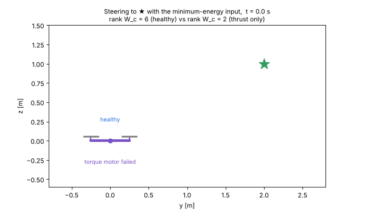

**Try it yourself:** set `xf = np.array([0, 1.0, 0, 0, 0, 0])` (straight up) and re-run. Now the thrust-only drone reaches it too. Why? (Because $[0,1,0,0,0,0]$ lies in its reachable subspace $\{z, v_z\}$.)

---

## Experiment 4 — Observability: what can the sensors tell us?

**Script:** [`lab/exp4_observability.py`](lab/exp4_observability.py) · **Concepts:** Concepts §6 · Solutions Task 0.3–0.4

A controller $u = -Kx$ needs the full state, but real drones only have sensors. Each sensor set is a $C$ matrix, $y_k = Cx_k$:

```text
altimeter (z)            rank W_o = 2 of 6   unobservable states: y, theta, vy, omega
gyroscope (omega)        rank W_o = 1 of 6   unobservable states: y, z, theta, vy, vz
GPS horizontal (y)       rank W_o = 4 of 6   unobservable states: z, vz
GPS + altimeter (y,z)    rank W_o = 6 of 6   unobservable states: none   -> observable
```

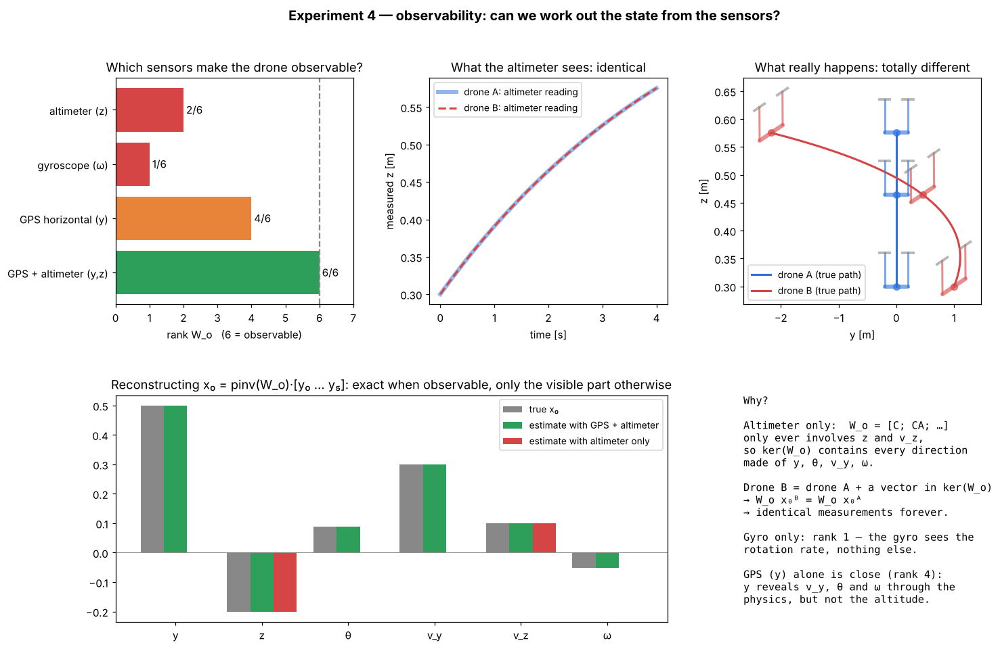

**Top: two drones, identical measurements.** Drone A starts 0.3 m high. Drone B starts at the same place **plus** a vector $h = [1,\ 0,\ 4°,\ 0.4,\ 0,\ 0]$ that lies in $\ker(W_o)$ for the altimeter, so $W_o h = 0$. By linearity, $W_o x_0^B = W_o x_0^A + W_o h = W_o x_0^A$. The altimeter readings are therefore **exactly identical** (the difference printed by the script is 0.00). Yet drone A only moves up, while drone B ends up more than 3 m from where it started, at $y = -2.2$ m. The altimeter has no way to tell them apart. That is what an **unobservable subspace** means: the directions that produce zero output.

**Bottom: reconstructing $x_0$ from the first 6 measurements.** Solving $W_o x_0 = [y_0; \dots; y_5]$ with the pseudo-inverse gives:

```text
true x0                    = [ 0.5   -0.2   0.0873  0.3   0.1  -0.0524]
estimate (GPS + altimeter) = [ 0.5   -0.2   0.0873  0.3   0.1  -0.0524]   exact
estimate (altimeter only)  = [ 0.    -0.2   0.      0.    0.1   0.    ]   only z, vz
```

With an observable sensor set the reconstruction is exact. With the altimeter alone, only the **observable component** ($z$, $v_z$) is recovered, and the unobservable directions come back as 0. This is the same split as Task 0.4: $x_0 = x_{\text{obs}} + x_{\text{unobs}}$, and the outputs only reveal $x_{\text{obs}}$.

**Why GPS alone almost works (rank 4).** It measures only $y$, yet the physics links the other sideways states to it. $y$ changes because of $v_y$, $v_y$ changes because of $\theta$, and $\theta$ changes because of $\omega$. Watching how $y$ evolves over several steps reveals all four. The rows $CA, CA^2, \dots$ of $W_o$ are exactly "how the measurement evolves". Altitude never affects $y$, so it stays hidden.

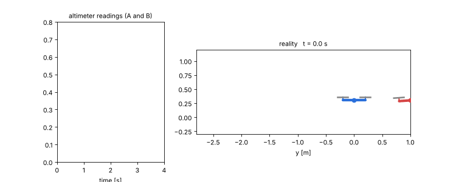

**Try it yourself:** add a sensor that measures the tilt, `sel(0, 1, 2)`. Does the rank change? (No, it is already 6. Extra sensors do not add rank once you have full rank, but they help against noise.)

---

## Experiment 5 — State feedback: moving the eigenvalues

**Script:** [`lab/exp5_state_feedback.py`](lab/exp5_state_feedback.py) · **Concepts:** Concepts §5.7, §7.1

With $u_k = -Kx_k$ the drone becomes $x_{k+1} = (A - BK)x_k$. Because the drone is **reachable**, $K$ can place the eigenvalues of $A - BK$ anywhere (pole placement). We design three controllers whose eigenvalues all lie at roughly 0.92, 0.80 and 0.55, and a fourth controller that is simply the medium one multiplied by 3. All four start from 1.5 m left, 0.5 m low, tilted 10°.

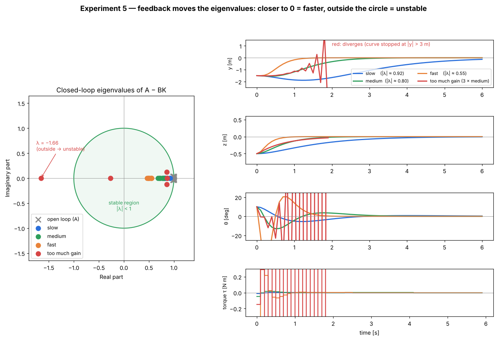

| controller | $\max\lvert\lambda(A - BK)\rvert$ | result | max torque |
|---|---|---|---|
| slow | 0.92 | stable, still 0.13 m off after 6 s | 0.010 N m |
| medium | 0.80 | stable, settled in about 3 s | 0.049 N m |
| fast | 0.55 | stable, settled in about 1.3 s, big tilt swings | 0.43 N m |
| 3 × medium | **1.66** | **unstable** | explodes |

**What to notice**

- The grey crosses (open loop) sit at 1. **Feedback pulls them into the circle**, and the further in, the faster the drone recovers. This is Experiment 1 again: the largest $|\lambda|$ sets the settling speed.
- **Fast costs effort:** the fast controller uses about 9× more torque than the medium one and tilts the drone more than 20°, which is beyond what the small-angle model is good for.
- **More gain is not always better.** Tripling the medium gain puts an eigenvalue at $\lambda = -1.66$, outside the circle. Because it is *negative*, the drone over-corrects and flips direction at every step, with growing amplitude. In discrete time, the controller only acts every $T_s$, so too strong a correction overshoots.


**Try it yourself:** change the factor `3 * K_med` to `2 * K_med`. Is it still stable? Find, by trial, the largest factor that keeps every $|\lambda| < 1$. (Answer: 2× is still stable with $\max|\lambda| = 0.86$; the limit lies between 2× and 2.5×.)

---

## Experiment 6 — Task 1 live: the tracking error

**Script:** [`lab/exp6_tracking_error.py`](lab/exp6_tracking_error.py) · **Concepts:** Concepts §7.2–7.3 · Solutions Task 1

Now the controller tracks a reference, $u_k = -K(x_k - x_{\text{ref}})$. Task 1 showed that

$$
x_\infty - x_{\text{ref}} = (I - A + BK)^{-1}(A - I)\,x_{\text{ref}},
\qquad\text{which is zero} \iff A x_{\text{ref}} = x_{\text{ref}} .
$$

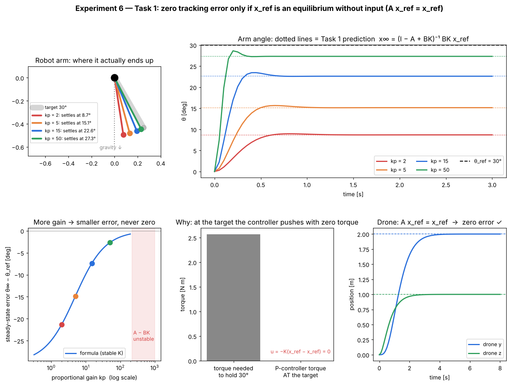

### The drone: zero error (bottom-right)

The target is "hover 2 m right, 1 m up": $x_{\text{ref}} = [2, 1, 0, 0, 0, 0]$. A drone hovering at rest stays where it is with $u = 0$, because positions are integrators. So $A x_{\text{ref}} = x_{\text{ref}}$:

```text
DRONE: A x_ref == x_ref ? True
  predicted error (I-A+BK)^-1 (A-I) x_ref = [0. 0. 0. 0. 0. 0.]
  simulated final state                   = [2. 1. 0. 0. 0. 0.]
```

The drone lands exactly on the target. This is the "condition holds" case of Task 1.

### The robot arm: steady-state error (everything else)

The target is "hold the arm at 30°": $x_{\text{ref}} = [30°, 0]$. Gravity pulls the arm back, so after one step from rest at 30° it would not stay there:

```text
ARM: A x_ref = [0.5109 -0.5019]  vs  x_ref = [0.5236 0.]  -> equal? False
```

The condition fails, so **no gain** gives zero error:

| $k_p$ | settles at (formula) | settles at (simulation) | error |
|---|---|---|---|
| 2 | 8.69° | 8.69° | −21.3° |
| 5 | 15.14° | 15.14° | −14.9° |
| 15 | 22.61° | 22.61° | −7.4° |
| 50 | 27.32° | 27.32° | −2.7° |

The simulated values match the Task 1 formula to every digit shown.

**Why it happens (bottom-middle panel).** To hold 30°, the motor must supply the holding torque $mgl\,\theta_{\text{ref}} \approx 2.6$ N m. But at the target the P-controller outputs $u = -K(x_{\text{ref}} - x_{\text{ref}}) = 0$. The arm therefore settles where the remaining error produces exactly the torque needed: $k_p(\theta_{\text{ref}} - \theta_\infty) = mgl\,\theta_\infty$. Solving gives

$$
\theta_\infty = \frac{k_p}{k_p + mgl}\,\theta_{\text{ref}} ,
$$

which is the Task 1 result $x_\infty = (I - A + BK)^{-1}BKx_{\text{ref}}$ written in physical terms for the arm. With $mgl = 4.9$ N m: $k_p = 5$ gives $\theta_\infty \approx 0.505\cdot 30° = 15.1°$ ✓.

**More gain helps, but it can't fix the problem (bottom-left).** The error shrinks as $k_p$ grows but never reaches zero. Beyond $k_p \approx 216$ the discrete closed loop becomes unstable (red band), just like the gain limit in the 1-D example of Task 1.2 and in Experiment 5.

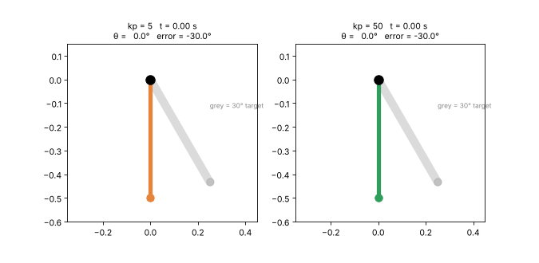

**Try it yourself**

- Change the damping ratio `zeta` in `arm_gain`. The transient changes, but the final angle does not. ($k_d$ multiplies $\omega$, and $\omega_{\text{ref}} = 0$, so it never enters the error.)
- Set `theta_ref = 0`. The error vanishes, because $x_{\text{ref}} = 0$ trivially satisfies $Ax_{\text{ref}} = x_{\text{ref}}$.

This sag is what **Task 2** (a reference prefilter $F$ that aims higher on purpose) and **Task 3** (an integrator that keeps adding torque until the error is zero) are designed to remove.

---

## Experiment 7 — Tasks 2 and 3 live: removing the sag

**Script:** [`lab/exp7_prefilter_vs_integrator.py`](lab/exp7_prefilter_vs_integrator.py) · **Concepts:** Concepts §7.4–7.9 · Solutions Parts D, E

Same arm, same 30° target, same $k_p = 15$ as Experiment 6. Three controllers are compared, first on the exact model and then on an arm carrying an **unknown 30 % extra payload**.

**The prefilter (Task 2).** Holding the arm at 30° needs the torque $\bar u = mgl\,\theta_{\text{ref}} = 2.568$ N m. This is the holding input $B\bar u = (I - A)x_{\text{ref}}$ from Concepts §7.4, and it exists because a hanging arm *can* be held at 30°. With $F = \operatorname{diag}(f, 1)$, the zero-error condition $KFx_{\text{ref}} = \bar u + Kx_{\text{ref}}$ becomes $k_pf\theta_{\text{ref}} = mgl\,\theta_{\text{ref}} + k_p\theta_{\text{ref}}$, so

$$
f = 1 + \frac{mgl}{k_p} = 1 + \frac{4.905}{15} = 1.327 .
$$

The controller is told to aim at $1.327 \times 30° = 39.8°$, and it ends exactly at 30°.

**The integrator (Task 3).** The arm has one motor and two states ($m < n$). A full-state integrator would always keep an eigenvalue at 1 (Task 3.3*), so we integrate only the angle error, $K_I = [k_I,\ 0]$. The gains are placed with `place_poles`: the two P poles plus one at 0.85.

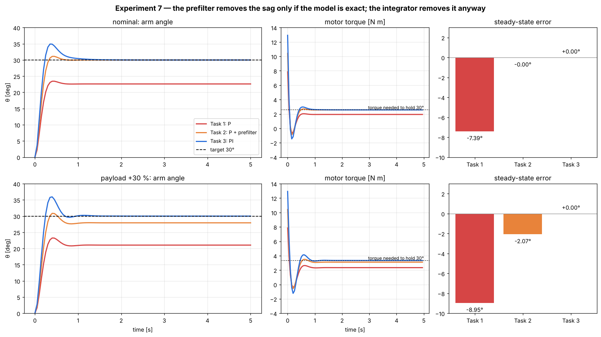

```text
  nominal        P   : final angle  22.61°  error  -7.39°   final torque 1.935 N m
  nominal        P+F : final angle  30.00°  error  -0.00°   final torque 2.568 N m
  nominal        PI  : final angle  30.00°  error  +0.00°   final torque 2.568 N m
  payload +30 %  P   : final angle  21.05°  error  -8.95°   final torque 2.343 N m
  payload +30 %  P+F : final angle  27.93°  error  -2.07°   final torque 3.109 N m
  payload +30 %  PI  : final angle  30.00°  error  +0.00°   final torque 3.339 N m
```

**What to notice**

- **Nominal arm:** both fixes work. Their final torque is exactly the holding torque, 2.568 N m (dotted line). The P controller only produces 1.935 N m, and the missing torque is "paid for" by the 7.4° sag.
- **Heavier arm:** now 30° needs $1.3 \times 2.568 = 3.339$ N m. The prefilter still adds the feedforward torque computed for the *old* mass, so a 2.1° sag returns (Task 2.3: it relies on the exact model). The integrator keeps adding torque as long as any error remains, and settles exactly at the new holding torque, 3.339 N m. It **learns** the torque instead of computing it (Solutions E.2, Step 5).
- **The price of integral action:** the PI response overshoots to about 35° before settling, and it uses larger torques at the start. The prefilter response is smoother.

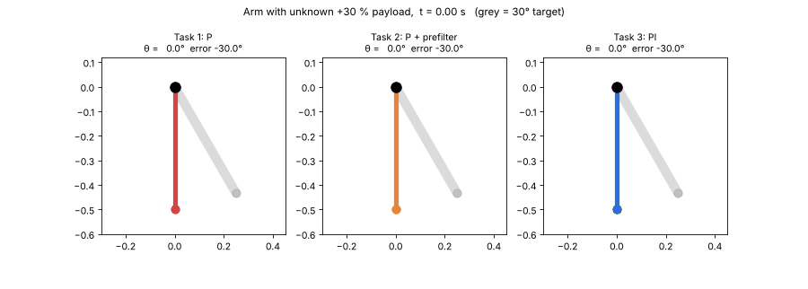

**Try it yourself**

- Change `heavy = robot_arm(m=1.3)` to `m=0.8` (a lighter arm). Which way does the prefilter's error go now?
- Increase the integrator pole from 0.85 to 0.95. The overshoot shrinks, but how long does it take to remove the sag?
- Set `KI = np.array([[G[0, 2], G[0, 2]]])`, i.e. also integrate the angular-velocity error. Look at the eigenvalues of the $4\times4$ $\tilde A$ (as in `python/task3_integrator.py`): with one motor, one of them is always exactly 1.

---

## Summary: what each formula looks like in real life

| Formula / term | In the lab |
|---|---|
| $\lambda$ with $\lvert\lambda\rvert < 1$ | a disturbance that dies out (Exp. 1, 5) |
| $\lambda = 1$ | something that stays where you leave it: a hovering drone's position (Exp. 2) |
| repeated $\lambda = 1$, too few eigenvectors | a tilt that makes the drone drift faster and faster (Exp. 2) |
| $\operatorname{rank} W_c = n$ | the motors can put the drone anywhere (Exp. 3) |
| reachable subspace | the only places a broken drone can still go (Exp. 3) |
| minimum number of steps | the first $N$ where the rank of $W_c(N)$ is full; feasible, but with huge inputs (Exp. 3) |
| $\ker W_o$ | a drift the altimeter cannot see (Exp. 4) |
| $\operatorname{rank} W_o = n$ | the sensors are enough to reconstruct the full state (Exp. 4) |
| $A - BK$ | the drone *with* its controller; its eigenvalues decide speed and stability (Exp. 5) |
| $(I - A + BK)^{-1}(A - I)x_{\text{ref}}$ | how far the arm sags below the target (Exp. 6) |
| $Ax_{\text{ref}} = x_{\text{ref}}$ | "the target is a place where the system would stay without any input" (Exp. 6) |
| $(I - A)x_{\text{ref}} = B\bar u$ | the torque needed to hold the arm at 30° (Exp. 7) |
| prefilter $F$ | "aim at 39.8° to land at 30°"; wrong as soon as the payload changes (Exp. 7) |
| integrator $e^i$ | keeps adding torque until the error is exactly zero, whatever the payload (Exp. 7) |
