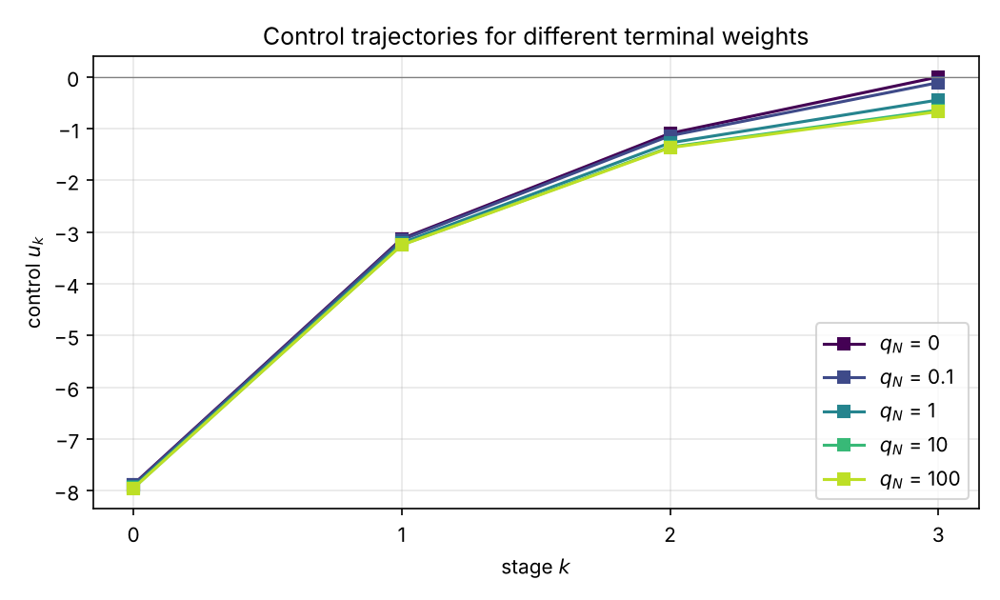
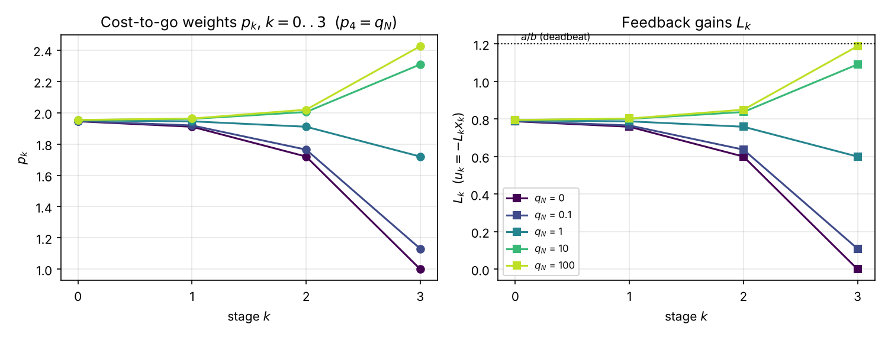

# Exercise 2 — Step-by-Step Solutions

**Course:** Optimization-Based Control Methods (TU Chemnitz, Automatic Control Group, Dr. Adrian Redder)
**Covers:** Tasks 1–4 (all parts), the numerical experiment and the additional task ⋆
**Checking:** no official solution was available when this was written. Every result is verified by the scripts in [`python/`](python/) (symbolic algebra, brute-force search and simulation).

Every step is written out. Section references like "Concepts §10.1" point to [`01_Concepts.md`](01_Concepts.md), which explains the theory behind each step.

---

## Contents

- [Part A — Task 1: Designing cost functions and state augmentation](#part-a--task-1-designing-cost-functions-and-state-augmentation)
- [Part B — Task 2: Scalar linear-quadratic DP](#part-b--task-2-scalar-linear-quadratic-dp)
- [Part C — Task 3: Finite-horizon discounted cost](#part-c--task-3-finite-horizon-discounted-cost)
- [Part D — Task 4: Tabular DP with hard constraints (EV charging)](#part-d--task-4-tabular-dp-with-hard-constraints-ev-charging)
- [Part E — Numerical experiment: effect of terminal costs](#part-e--numerical-experiment-effect-of-terminal-costs)
- [Part F — Additional task ⋆: monotonicity of DP](#part-f--additional-task--monotonicity-of-dp)
- [Summary of results](#summary-of-results)

---

## Part A — Task 1: Designing cost functions and state augmentation

Setting: $x_{k+1} = f_k(x_k,u_k,w_k)$, cost $\mathbb{E}\big[g_N(x_N) + \sum_{k=0}^{N-1}g_k(x_k,u_k,w_k)\big]$ (Concepts §3).

### A.1 Task 1(a) — Quadratic stage cost

$g_k = \lVert x_k - x_{\text{ref}}\rVert^2 + r\lVert u_k\rVert^2$, $\;g_N = \lVert x_N - x_{\text{ref}}\rVert^2$, $r\ge0$.

#### (i) The engineering objective

Read the cost term by term:

- $\lVert x_k - x_{\text{ref}}\rVert^2$ at every stage $k = 0,\dots,N-1$: the state should stay close to the reference **along the whole trajectory**, and the square punishes large deviations much more than small ones.
- $\lVert x_N - x_{\text{ref}}\rVert^2$: the state should also **end** close to the reference.
- $r\lVert u_k\rVert^2$: control effort (energy, actuator load) is expensive; $r$ sets its price relative to accuracy.

So the cost describes **set-point regulation (tracking a constant reference) with limited control effort**: bring the system to $x_{\text{ref}}$ quickly and keep it there, without using unreasonably large inputs. Example: drive a motor to a desired position, or hold a furnace at a desired temperature, without overloading the actuator.

#### (ii) $r = 0$ versus $r > 0$, and which penalties $u_k$ affects

**Which terms can $u_k$ influence?** The timing at stage $k$ is: measure $x_k$ → apply $u_k$ → $w_k$ happens → $x_{k+1} = f_k(x_k,u_k,w_k)$. So $x_k$ is already fixed when $u_k$ is chosen, and

- $u_k$ **does not** affect the current penalty $\lVert x_k - x_{\text{ref}}\rVert^2$;
- $u_k$ **does** affect $x_{k+1}$ and, through it, all later states, so it affects the **future** penalties $\lVert x_{k+1} - x_{\text{ref}}\rVert^2,\dots,\lVert x_{N-1} - x_{\text{ref}}\rVert^2$ and $g_N(x_N)$;
- $u_k$ affects its own effort term $r\lVert u_k\rVert^2$ (and none of the other effort terms directly).

In DP terms: $u_k$ minimises $r\lVert u_k\rVert^2 + \mathbb{E}\big[J_{k+1}(x_{k+1})\big]$, where $J_{k+1}$ collects all future penalties. The term $\lVert x_k - x_{\text{ref}}\rVert^2$ is a constant in this minimisation.

**$r = 0$ (effort is free).** Only the future state penalties matter, so the controller uses whatever input brings the next states closest to $x_{\text{ref}}$, however large it is. For example, for the scalar system $x_{k+1} = ax_k + bu_k$ ($b\ne0$) the choice $u_k = (x_{\text{ref}} - ax_k)/b$ puts $x_{k+1} = x_{\text{ref}}$ exactly in one step (**deadbeat** control). Consequences: very large inputs when the state is far away, saturation and wear in a real actuator, high sensitivity to noise and model errors. If $B$ cannot move the state in every direction, the optimal input may not even be unique (several inputs give the same next state).

**$r > 0$ (effort costs).** Each input is a trade-off: a larger $u_k$ lowers future deviations but raises $r\lVert u_k\rVert^2$. The key lemma (Concepts §1.3) shows the optimum then removes only part of the predicted error at each stage, so the state approaches $x_{\text{ref}}$ gradually with smaller, smoother inputs. Larger $r$ ⇒ slower, gentler response; $r\to0$ ⇒ approaches the deadbeat behaviour.

### A.2 Task 1(b) — Causality of the disturbances

Unroll the dynamics (Concepts §3.4):
$$
x_1 = f_0(x_0,u_0,w_0),\; x_2 = f_1(x_1,u_1,w_1),\;\dots,\; x_N = f_{N-1}(x_{N-1},u_{N-1},w_{N-1}).
$$

**Initial disturbance $w_0$.**

- It enters $x_1$ directly, and every later state through the chain: $x_1, x_2, \dots, x_N$ all depend on $w_0$.
- With feedback $u_k = \mu_k(x_k)$, the inputs $u_1,\dots,u_{N-1}$ depend on $w_0$ too.
- Hence $w_0$ influences the stage cost $g_0(x_0,u_0,w_0)$ (only through its explicit $w_0$ argument; $x_0$ and $u_0$ are fixed before $w_0$), all stage costs $g_1,\dots,g_{N-1}$, and the terminal cost $g_N(x_N)$. In short: **every term in (2)** can be affected.

**Final disturbance $w_{N-1}$.**

- It enters only $x_N = f_{N-1}(x_{N-1},u_{N-1},w_{N-1})$. The states $x_0,\dots,x_{N-1}$ and inputs $u_0,\dots,u_{N-1}$ are all determined before it.
- Hence it influences only $g_{N-1}(x_{N-1},u_{N-1},w_{N-1})$ (through its explicit argument, if $g_{N-1}$ depends on $w$) and the terminal cost $g_N(x_N)$.

**Can a feedback controller react to $w_{N-1}$?** No. A controller can react to a disturbance only through an input chosen **after** the disturbance has shown itself in the state. $w_{N-1}$ appears for the first time in $x_N$, but the last input is $u_{N-1}$, chosen before $w_{N-1}$ is realised. There is no $u_N$. The effect of $w_{N-1}$ on $g_N$ must simply be accepted, which is why, in Task 2(c), the noise adds a cost that no policy can remove.

*Check:* `python/task1_state_augmentation.py` perturbs $w_0$ and $w_{N-1}$ in a closed-loop simulation: $w_0$ changes $x_1,\dots,x_N$ and all later cost terms; $w_{N-1}$ changes only $x_N$ and $g_N$.

### A.3 Task 1(c) — Interpreting stage costs

#### (i) Barrier / indicator penalty

$$
g(x_k,u_k) = \begin{cases} x_k^2 + u_k^2, & |x_k|\le\bar x,\\ +\infty, & \text{otherwise.}\end{cases}
$$

- Inside the band $[-\bar x,\bar x]$ it is the usual quadratic regulation cost.
- Outside, the cost is infinite, so any policy that lets the state leave the band (with positive probability) has infinite expected cost. DP will never choose it if any alternative exists.
- This is a **hard state constraint** written as a cost (Concepts §9.3), equivalent to restricting the admissible inputs to those that keep $|x_{k+1}|\le\bar x$.

Use cases: limits that must never be violated — safety limits (pressure in a vessel, temperature of a battery cell, joint limits of a robot, a vehicle staying on the road).

#### (ii) Soft constraint / dead-zone penalty

$$
g(x_k,u_k) = x_k^2 + u_k^2 + \lambda\max\big(0,\,|x_k| - \bar x\big)^2,\qquad \lambda,\bar x > 0 .
$$

- For $|x_k|\le\bar x$: $|x_k| - \bar x\le 0$, so the max is $0$. No extra cost (the **dead zone**).
- For $|x_k| > \bar x$: extra cost $\lambda(|x_k| - \bar x)^2$, which grows smoothly with the size of the violation. $\lambda$ sets how strongly violations are discouraged.
- Use cases: comfort or performance limits that may be exceeded occasionally (room temperature band, preferred operating range of a process, recommended speed).

**Comparison when disturbances can push $x_k$ slightly beyond $[-\bar x,\bar x]$:**

- With the barrier (i), a violation caused by noise is not a "small mistake" — it is infinitely costly. If the noise can push the state out with positive probability no matter what the controller does, **every** policy has infinite expected cost: the DP values are all $+\infty$ and give no useful answer. Even when this can be avoided, the controller becomes extremely conservative: it keeps the state far from the boundary (or uses large inputs) to leave a safety margin larger than any possible disturbance.
- With the soft penalty (ii), a small violation costs a small amount (for example, with $\bar x = 1$, $\lambda = 50$: $x = 1.05$ adds only $50\cdot0.05^2 = 0.125$), so the expected cost stays finite. The controller still pushes the state back, more strongly the further out it is, and accepts occasional small, disturbance-caused violations. The problem remains well-posed and the behaviour degrades gracefully.

*Check:* `python/task1_state_augmentation.py` prints both costs for $x = 0.5, 1, 1.05, 1.2, 2$.

#### (iii) Economic objective

$$
g(x_k,u_k) = -\big(\text{Revenue}(x_k) - \text{Cost}(x_k,u_k)\big).
$$

- Revenue minus cost is the **profit** of stage $k$; minimising its negative is maximising total profit (Concepts §1.1, §9.5).
- Stage costs are typically negative here (the system earns money), which the DP framework allows (Concepts §3.2).
- There is no reference: the optimiser decides on its own which operating point is most profitable. This is the idea of **economic MPC**.
- Use cases: a battery storage system buying electricity when it is cheap and selling it when it is expensive; a chemical plant choosing throughput to maximise profit; a warehouse balancing sales against holding costs; an EV fleet scheduling charging against electricity prices.
- Caution: without constraints or effort costs, an economic objective can be unbounded below (for example, "produce infinitely much"), so physical limits must be included.

#### (iv) Slew-rate (input-change) penalty

$$
g(u_k,u_{k-1}) = u_k^2 + \rho\,(u_k - u_{k-1})^2,\qquad \rho > 0 .
$$

**Meaning.** $u_k - u_{k-1}$ is the change of the input between stages. Penalising it makes the input change smoothly instead of jumping. Use cases: valves, motors and steering that wear out or excite vibrations under sudden changes; limiting jerk for passenger comfort; avoiding chattering of a controller.

**Why it violates the standard DP form.** DP requires the stage cost at stage $k$ to be a function $g_k(x_k,u_k,w_k)$ of the **current** state, the current input and the current disturbance (Concepts §3.3). Here the cost also needs $u_{k-1}$, the **previous** input. If the state $x_k$ does not contain $u_{k-1}$, then at stage $k$ the recursion
$J_k(x_k) = \min_{u_k}\mathbb{E}[g_k + J_{k+1}]$ cannot even be evaluated: two histories that lead to the same $x_k$ but different $u_{k-1}$ have different costs ahead of them, so a cost-to-go that depends on $x_k$ alone cannot be correct. The Markov property ("the state summarises the past") is broken.

**Restoring the DP framework by state augmentation (Concepts §9.6).**

1. *Augmented state:* store the previous input as an extra state component,
   $$\tilde x_k := \begin{bmatrix} x_k \\ z_k\end{bmatrix},\qquad z_k := u_{k-1}.$$
2. *Augmented dynamics:* the new memory component simply records the input that was just applied:
   $$\tilde x_{k+1} = \begin{bmatrix} x_{k+1} \\ z_{k+1}\end{bmatrix} = \begin{bmatrix} f_k(x_k,u_k,w_k) \\ u_k\end{bmatrix} =: \tilde f_k(\tilde x_k,u_k,w_k).$$
   This depends only on $(\tilde x_k, u_k, w_k)$. ✓
3. *Augmented stage cost:* replace $u_{k-1}$ by the state component $z_k$:
   $$\tilde g_k(\tilde x_k,u_k) = u_k^2 + \rho\,(u_k - z_k)^2 .$$
   This depends only on $(\tilde x_k,u_k)$. ✓ (Any state cost, for example $+x_k^2$, can be added as usual.)
4. *Initial condition:* $\tilde x_0 = (x_0,\,u_{-1})$, where $u_{-1}$ is the input applied before the start (for example $u_{-1} = 0$ if the actuator is at rest).

Now the problem is a standard Markovian DP problem in $\tilde x$, the DP algorithm applies, and the optimal policy has the form $u_k = \mu_k(x_k, u_{k-1})$: the best input depends on the current state **and** where the actuator currently is. The price is a larger state (dimension $n + m$ instead of $n$), which makes a tabulated DP more expensive (curse of dimensionality, Concepts §6.3).

*Check:* `python/task1_state_augmentation.py` solves a small slew-rate problem with DP on the augmented state $(x, u_{\text{prev}})$ and with brute force over all input sequences; both give the same optimal cost (63).

---

## Part B — Task 2: Scalar linear-quadratic DP

System $x_{k+1} = ax_k + bu_k$, $k = 0,1,2,3$ ($N = 4$), $a,b\in\mathbb{R}$, $b\ne0$, $u_k\in\mathbb{R}$ unconstrained. This is the special case $q = r = 1$ of Concepts §10.

### B.1 Task 2(a) — Backward induction with unit terminal weight

Cost (3): $J(x_0;u_0,\dots,u_3) = x_4^2 + \sum_{k=0}^{3}(x_k^2 + u_k^2)$.
So $g_N(x_4) = x_4^2$ and $g_k(x_k,u_k) = x_k^2 + u_k^2$.

**DP recursion for this problem** (Concepts §6.1, no noise so no expectation):
$$
J_4(x_4) = x_4^2,\qquad J_k(x_k) = \min_{u_k\in\mathbb{R}}\Big\lbrace x_k^2 + u_k^2 + J_{k+1}(ax_k + bu_k)\Big\rbrace,\quad k = 3,2,1,0.
$$

#### Stage $k = 4$ (base case)

No inputs remain: $J_4(x_4) = x_4^2 = p_4x_4^2$ with $\boxed{p_4 = 1}$. The claim $J_k = p_kx_k^2$ holds for $k = 4$.

#### Stage $k = 3$ (worked out in full)

$$
J_3(x_3) = \min_{u_3}\Big\lbrace x_3^2 + u_3^2 + p_4(ax_3 + bu_3)^2\Big\rbrace .
$$
Call the bracket $Q_3(u_3)$.

*Step 1 — stationary point.* Differentiate with respect to $u_3$ ($x_3$ is a constant):
$$
\frac{\partial Q_3}{\partial u_3} = 2u_3 + 2p_4b\,(ax_3 + bu_3) = 0 .
$$
Divide by 2 and collect the $u_3$ terms: $u_3(1 + b^2p_4) = -abp_4x_3$, so
$$
u_3^\star = -\frac{abp_4}{1 + b^2p_4}\,x_3 .
$$

*Step 2 — it is a minimum.* $\dfrac{\partial^2Q_3}{\partial u_3^2} = 2 + 2b^2p_4 = 2(1 + b^2p_4) > 0$ because $p_4 = 1 > 0$. $Q_3$ is a strictly convex parabola in $u_3$, so $u_3^\star$ is its unique global minimiser (Concepts §1.2).

*Step 3 — the value.* First the next state:
$$
ax_3 + bu_3^\star = ax_3 - \frac{ab^2p_4}{1 + b^2p_4}x_3 = ax_3\,\frac{1 + b^2p_4 - b^2p_4}{1 + b^2p_4} = \frac{a}{1 + b^2p_4}\,x_3 .
$$
Then
$$
u_3^{\star2} + p_4(ax_3 + bu_3^\star)^2 = \frac{a^2b^2p_4^2}{(1 + b^2p_4)^2}x_3^2 + \frac{p_4a^2}{(1 + b^2p_4)^2}x_3^2 = \frac{a^2p_4\,(b^2p_4 + 1)}{(1 + b^2p_4)^2}x_3^2 = \frac{a^2p_4}{1 + b^2p_4}x_3^2 .
$$
Adding the term $x_3^2$:
$$
J_3(x_3) = \Big(1 + \frac{a^2p_4}{1 + b^2p_4}\Big)x_3^2 = p_3x_3^2,\qquad p_3 = 1 + \frac{a^2p_4}{1 + b^2p_4} = \boxed{1 + \frac{a^2}{1 + b^2}} .
$$
So $J_3$ is again quadratic in $x_3$, and $\mu_3^\star(x_3) = -\dfrac{ab}{1 + b^2}\,x_3$.

#### General induction step $k + 1\to k$

*Hypothesis:* $J_{k+1}(x) = p_{k+1}x^2$ with some $p_{k+1}\ge0$.

Exactly the same three steps as for $k = 3$, with $p_4$ replaced by $p_{k+1}$ (or directly the key lemma, Concepts §1.3, with $r = 1$, $c = ax_k$, $\beta = b$, $p = p_{k+1}$):
$$
J_k(x_k) = x_k^2 + \min_{u_k}\Big\lbrace u_k^2 + p_{k+1}(ax_k + bu_k)^2\Big\rbrace = x_k^2 + \frac{a^2p_{k+1}}{1 + b^2p_{k+1}}x_k^2 = p_kx_k^2,
$$
with minimiser $u_k^\star = -\dfrac{abp_{k+1}}{1 + b^2p_{k+1}}x_k$. The second derivative $2(1 + b^2p_{k+1})$ is positive since $p_{k+1}\ge0$, and the new $p_k = 1 + (\dots)\ge 1 > 0$, so the hypothesis carries over to the next step.

#### Stages $k = 2, 1, 0$

Applying the step three more times (each time the hypothesis holds because the previous step produced a quadratic):
$$
J_2(x_2) = p_2x_2^2,\; p_2 = 1 + \frac{a^2p_3}{1 + b^2p_3};\qquad
J_1(x_1) = p_1x_1^2,\; p_1 = 1 + \frac{a^2p_2}{1 + b^2p_2};\qquad
J_0(x_0) = p_0x_0^2,\; p_0 = 1 + \frac{a^2p_1}{1 + b^2p_1}.
$$

**Result.**

$$
\boxed{\;p_4 = 1,\qquad p_k = 1 + \frac{a^2\,p_{k+1}}{1 + b^2\,p_{k+1}}\quad(k = 3,2,1,0)\;}
$$

(equivalently, in Riccati form, $p_k = 1 + a^2p_{k+1} - \dfrac{a^2b^2p_{k+1}^2}{1 + b^2p_{k+1}}$, Concepts §10.1).

**Optimal feedback policy** $\pi^\star = \lbrace\mu_0^\star,\mu_1^\star,\mu_2^\star,\mu_3^\star\rbrace$ with

$$
\boxed{\;\mu_k^\star(x_k) = -L_k\,x_k,\qquad L_k = \frac{a\,b\,p_{k+1}}{1 + b^2\,p_{k+1}},\quad k = 0,1,2,3\;}
$$

that is, $\mu_3^\star(x) = -\dfrac{ab}{1 + b^2}x$, $\;\mu_2^\star(x) = -\dfrac{abp_3}{1 + b^2p_3}x$, $\;\mu_1^\star(x) = -\dfrac{abp_2}{1 + b^2p_2}x$, $\;\mu_0^\star(x) = -\dfrac{abp_1}{1 + b^2p_1}x$. The optimal cost is $J^\star(x_0) = p_0x_0^2$.

The policy is **linear state feedback with time-varying gain**: the gains differ from stage to stage because the remaining horizon differs (Concepts §10.1).

*Example* ($a = 1.2$, $b = 1$): $p_4 = 1$, $p_3 = 1 + 1.44/2 = 1.72$, $p_2 = 1.9106$, $p_1 = 1.9453$, $p_0 = 1.9511$; gains $L_3 = 0.6$, $L_2 = 0.7588$, $L_1 = 0.7877$, $L_0 = 0.7926$.

*Check:* `python/task2_scalar_lq_dp.py` verifies the induction step symbolically and compares $p_0x_0^2$ with a brute-force numerical minimisation over $(u_0,\dots,u_3)$ for random $a, b, q_N, x_0$: they agree to all digits shown.

### B.2 Task 2(b) — Variable terminal weight $q_N\ge0$

Cost (4): $q_Nx_4^2 + \sum_{k=0}^{3}(x_k^2 + u_k^2)$.

**What changes.** Only the terminal cost, i.e. only the **initialisation** of the recursion: $J_4(x_4) = q_Nx_4^2$, so $p_4 = q_N$. The induction step of B.1 never used $p_4 = 1$, only $p_{k+1}\ge 0$, so it is unchanged:

$$
\boxed{\;p_4 = q_N,\qquad p_k = 1 + \frac{a^2p_{k+1}}{1 + b^2p_{k+1}},\qquad \mu_k^\star(x_k) = -\frac{abp_{k+1}}{1 + b^2p_{k+1}}\,x_k\;}
$$

The **form** of the policy is the same (linear feedback); the **gains** change, because every $p_k$ now depends on $q_N$. Unit weight (Task 2(a)) is the case $q_N = 1$.

**The last decision.** With $p_4 = q_N$:
$$
\mu_3^\star(x_3) = -\frac{ab\,q_N}{1 + b^2q_N}\,x_3 .
$$
For $q_N = 0$:
$$
\boxed{\;\mu_3^\star(x_3) = 0\;}\qquad\text{and}\qquad p_3 = 1 + 0 = 1 .
$$

**Why this is physically intuitive.** At stage $3$ the cost still to be paid is $x_3^2 + u_3^2 + q_Nx_4^2$.

- $x_3^2$ is already fixed — $u_3$ cannot change it (Task 1(a)(ii)).
- The only thing $u_3$ can influence is $x_4$, and with $q_N = 0$ the final state is **free**: nobody cares where it ends.
- But $u_3$ costs $u_3^2$.

Spending effort to change something that is not rewarded is pure waste, so the best last action is to do nothing. The state is left to drift: $x_4 = ax_3$. (In a real system this is why a finite-horizon controller without terminal cost "gives up" at the end; Part E shows it.)

A side observation: with $q_N = 0$ we get $p_3 = 1$, which is exactly the value of $p_4$ in the unit-weight problem. So the $q_N = 0$ problem over 4 stages behaves like the $q_N = 1$ problem over 3 stages, shifted by one step (visible in the table of Part E).

### B.3 Task 2(c) — Additive zero-mean noise

Dynamics $x_{k+1} = ax_k + bu_k + w_k$ with $\mathbb{E}[w_k] = 0$, $\mathbb{E}[w_k^2] = \sigma^2 > 0$ (white: independent across $k$), cost (4) in expectation.

**DP recursion:**
$$
J_4(x_4) = q_Nx_4^2,\qquad J_k(x_k) = \min_{u_k}\mathbb{E}_{w_k}\Big[x_k^2 + u_k^2 + J_{k+1}(ax_k + bu_k + w_k)\Big].
$$

**Claim:** $J_k(x_k) = p_kx_k^2 + c_k$ with $p_k$ from B.2 and $c_4 = 0$, $c_k = c_{k+1} + p_{k+1}\sigma^2$.

*Base case $k = 4$:* $J_4 = q_Nx_4^2 + 0$, so $p_4 = q_N$, $c_4 = 0$. ✓

*Induction step.* Assume $J_{k+1}(x) = p_{k+1}x^2 + c_{k+1}$. Write $m := ax_k + bu_k$; inside the expectation over $w_k$, $x_k$ and $u_k$ are fixed, so $m$ is a constant.

1. Insert the hypothesis:
   $$\mathbb{E}_{w_k}\big[J_{k+1}(m + w_k)\big] = \mathbb{E}\big[p_{k+1}(m + w_k)^2 + c_{k+1}\big].$$
2. Expand the square: $(m + w_k)^2 = m^2 + 2mw_k + w_k^2$.
3. Take the expectation term by term (linearity, Concepts §1.4):
   $$= p_{k+1}\big(m^2 + 2m\underbrace{\mathbb{E}[w_k]}_{=0} + \underbrace{\mathbb{E}[w_k^2]}_{=\sigma^2}\big) + c_{k+1} = p_{k+1}m^2 + p_{k+1}\sigma^2 + c_{k+1}.$$
4. The terms $x_k^2$ and $u_k^2$ are not random, so
   $$J_k(x_k) = \min_{u_k}\Big\lbrace x_k^2 + u_k^2 + p_{k+1}(ax_k + bu_k)^2\Big\rbrace + p_{k+1}\sigma^2 + c_{k+1}.$$
5. The last two terms do not depend on $u_k$, so they come out of the minimisation (Concepts §1.1). What remains is **exactly** the deterministic problem of B.1/B.2, with minimum $p_kx_k^2$ and the same minimiser.

Hence
$$
\boxed{\;J_k(x_k) = p_kx_k^2 + c_k,\qquad c_k = c_{k+1} + p_{k+1}\sigma^2,\; c_4 = 0\;}
$$
with $p_k$ following the same recursion as in part (b). Unrolling: $c_3 = q_N\sigma^2$, $c_2 = (q_N + p_3)\sigma^2$, …, $c_0 = \sigma^2(p_4 + p_3 + p_2 + p_1)$.

**Does the noise change the optimal feedback?** **No.** The minimiser in step 5 is the same, so
$$
\mu_k^\star(x_k) = -\frac{abp_{k+1}}{1 + b^2p_{k+1}}\,x_k \quad\text{(identical to the noise-free case).}
$$
This is **certainty equivalence** (Concepts §10.3): for linear dynamics, quadratic cost and additive zero-mean noise, the optimal controller is the one designed for the noise-free system. The noise only adds the constant $c_0 = \sigma^2\sum_{k=0}^{3}p_{k+1}$ to the optimal cost: an unavoidable price, since each $w_k$ arrives after $u_k$ is chosen and its spread cannot be influenced by $u_k$. (The *realised* inputs are of course different, because the measured states are different.)

*Check:* `python/task2_scalar_lq_dp.py` confirms symbolically that the minimiser is unchanged and that the constant is $c_{k+1} + p_{k+1}\sigma^2$. A Monte Carlo simulation ($a = 1.2$, $b = 1$, $q_N = 1$, $x_0 = 10$, $\sigma = 0.5$, 400 000 runs) gives an average cost of $196.76$, matching $p_0x_0^2 + c_0 = 195.11 + 1.64 = 196.75$.

---

## Part C — Task 3: Finite-horizon discounted cost

Cost $J_\pi(x_0) = \mathbb{E}\big[\alpha^Ng_N(x_N) + \sum_{k=0}^{N-1}\alpha^kg_k(x_k,u_k,w_k)\big]$, $\alpha\in(0,1)$; rescaled cost-to-go $V_k(x_k) := \alpha^{-k}J_k(x_k)$.

### C.1 Task 3(a) — Recursion for $V_k$

**Standard DP for the discounted problem.** The discounted problem is an ordinary DP problem with stage cost $\tilde g_k := \alpha^kg_k$ and terminal cost $\tilde g_N := \alpha^Ng_N$. So (Concepts §6.1):
$$
J_N(x_N) = \alpha^Ng_N(x_N),\qquad
J_k(x_k) = \min_{u_k\in U_k(x_k)}\mathbb{E}_{W_k}\Big[\alpha^kg_k(x_k,u_k,W_k) + J_{k+1}\big(f_k(x_k,u_k,W_k)\big)\Big].
$$

**Terminal stage.** Multiply by $\alpha^{-N}$:
$$
V_N(x_N) = \alpha^{-N}J_N(x_N) = \alpha^{-N}\alpha^Ng_N(x_N) = g_N(x_N). \;\checkmark
$$

**Stages $k = N-1,\dots,0$.** Two facts about the positive number $\alpha^{-k}$:

- (F1) a positive constant can be moved into a minimum: $c\min_uh(u) = \min_u\,c\,h(u)$ for $c > 0$ (multiplying by $c > 0$ preserves the order of all values, so the same $u$ is smallest and the smallest value is scaled by $c$);
- (F2) a constant can be moved into an expectation: $c\,\mathbb{E}[X] = \mathbb{E}[cX]$ (linearity).

Now:
$$
\begin{aligned}
V_k(x_k) &= \alpha^{-k}J_k(x_k) && \text{definition}\\
&= \alpha^{-k}\min_{u_k}\mathbb{E}\Big[\alpha^kg_k(x_k,u_k,W_k) + J_{k+1}(f_k(x_k,u_k,W_k))\Big] && \text{DP recursion}\\
&= \min_{u_k}\mathbb{E}\Big[\alpha^{-k}\alpha^kg_k(x_k,u_k,W_k) + \alpha^{-k}J_{k+1}(f_k(x_k,u_k,W_k))\Big] && \text{(F1), (F2)}\\
&= \min_{u_k}\mathbb{E}\Big[g_k(x_k,u_k,W_k) + \alpha^{-k}J_{k+1}(f_k(x_k,u_k,W_k))\Big] && \alpha^{-k}\alpha^k = 1 .
\end{aligned}
$$
Finally, by the definition of $V_{k+1}$, $J_{k+1} = \alpha^{k+1}V_{k+1}$, so $\alpha^{-k}J_{k+1} = \alpha^{-k}\alpha^{k+1}V_{k+1} = \alpha V_{k+1}$. Therefore

$$
\boxed{\;V_N(x_N) = g_N(x_N),\qquad V_k(x_k) = \min_{u_k\in U_k(x_k)}\mathbb{E}_{W_k}\Big[g_k(x_k,u_k,W_k) + \alpha\,V_{k+1}\big(f_k(x_k,u_k,W_k)\big)\Big]\;}
$$

for $k = N-1,\dots,0$, as required. By (F1) the minimising $u_k$ is the same in both recursions, so $V_k$ and $J_k$ define **the same optimal policy**, and the optimal cost is $J^\star(x_0) = J_0(x_0) = \alpha^0V_0(x_0) = V_0(x_0)$.

### C.2 Task 3(b) — Why $V_k$ is better for time-invariant problems

Assume $f_k = f$, $g_k = g$ (and, as usual for time invariance, the same constraint set $U$ and i.i.d. disturbances).

1. **One operator, used at every stage.** In the $J$-recursion the stage cost $\alpha^kg$ carries the calendar time $k$, so each stage has a different right-hand side. In the $V$-recursion, nothing depends on $k$:
   $$V_k = TV_{k+1},\qquad (TV)(x) := \min_{u\in U(x)}\mathbb{E}\big[g(x,u,W) + \alpha V(f(x,u,W))\big].$$
   The same Bellman operator $T$ is applied at every stage, so $V_k = T^{N-k}g_N$. One implementation serves all stages.
2. **Depends only on the steps to go.** $V_k$ (and the policy $\mu_k^\star$) depends only on the number of remaining stages $N - k$, not on the absolute time. So the result for one horizon can be reused for another: $V_k$ for horizon $N$ equals $V_{k+1}$ for horizon $N + 1$, and extending the horizon by one stage costs one more application of $T$. Policies can be stored as "what to do with $j$ steps left".
3. **Numerically well scaled.** $J_k$ contains the factor $\alpha^k$ and shrinks towards zero as $k$ grows (for $\alpha = 0.5$ and $N = 1200$, $\alpha^N$ underflows to exactly $0$ in double precision), so late-stage values lose precision or vanish. $V_k$ stays on the scale of the actual costs $g$ and $g_N$ ("current-value" units: cost measured as seen from the stage where it is paid).
4. **Bridge to the infinite horizon.** As $N - k\to\infty$, $V_k = T^{N-k}g_N$ converges to the fixed point $V^\star = TV^\star$ (value iteration; $T$ is a contraction with factor $\alpha$, Concepts §14), giving a **stationary** optimal policy $\mu^\star(x)$. The $J_k$-form has no such limit: $J_k\to0$ only because of the $\alpha^k$ factor, which hides the useful information.

*Check:* `python/task3_discounted_dp.py` verifies on a random finite MDP that $V_k = \alpha^{-k}J_k$ at every stage, that both give the same actions, that $V_k$ depends only on steps to go, and that the value-iteration differences shrink by about $\alpha$ per step.

---

## Part D — Task 4: Tabular DP with hard constraints (EV charging)

Data: $x_k\in\lbrace0,1,2\rbrace$ kWh, $x_0 = 0$; $u_k\in\lbrace0,1\rbrace$; $x_{k+1} = x_k + u_k$ must stay in $\lbrace0,1,2\rbrace$; $N = 2$.

- $g_0(x_0,u_0) = 2u_0 + u_0^2$ (night, cheap): $g_0 = 0$ for $u_0 = 0$, $g_0 = 3$ for $u_0 = 1$.
- $g_1(x_1,u_1) = 4u_1 + u_1^2$ (morning peak): $g_1 = 0$ for $u_1 = 0$, $g_1 = 5$ for $u_1 = 1$.
- $g_2(x_2) = 5(2 - x_2)^2$ (departure, target full battery).

**Admissible inputs (the hard constraint).** $x_{k+1} = x_k + u_k\le2$, so: for $x_k\in\lbrace0,1\rbrace$, $U(x_k) = \lbrace0,1\rbrace$; for $x_k = 2$, $U(2) = \lbrace0\rbrace$ (a full battery cannot be charged). The constraint is enforced by not listing infeasible inputs (Concepts §12).

### D.1 Task 4(a) — $J_2$, then $J_1$ and $\mu_1^\star$

**Stage 2 (terminal).** $J_2(x_2) = 5(2 - x_2)^2$:

| $x_2$ | $J_2(x_2)$ |
|:-:|:-:|
| 0 | $5\cdot2^2 = 20$ |
| 1 | $5\cdot1^2 = 5$ |
| 2 | $5\cdot0^2 = 0$ |

**Stage 1.** $J_1(x_1) = \min_{u_1\in U(x_1)}\big\lbrace g_1(u_1) + J_2(x_1 + u_1)\big\rbrace$:

| $x_1$ | $u_1 = 0$: $\;g_1 + J_2(x_1)$ | $u_1 = 1$: $\;g_1 + J_2(x_1 + 1)$ | $J_1(x_1)$ | $\mu_1^\star(x_1)$ |
|:-:|:-:|:-:|:-:|:-:|
| 0 | $0 + 20 = 20$ | $5 + 5 = 10$ | **10** | **1** |
| 1 | $0 + 5 = 5$ | $5 + 0 = 5$ | **5** | **0 or 1** (tie) |
| 2 | $0 + 0 = 0$ | not admissible ($x_2 = 3$) | **0** | **0** |

Reading the table:

- $x_1 = 0$: charging during the peak costs $5$ but cuts the departure penalty from $20$ to $5$, so it is worth it.
- $x_1 = 1$: charging costs exactly $5$ and saves exactly $5$ ($J_2$ drops from $5$ to $0$). Both actions are optimal: $\mu_1^\star(1)\in\lbrace0,1\rbrace$.
- $x_1 = 2$: nothing to do.

### D.2 Task 4(b) — $J_0(0)$, $\mu_0^\star(0)$ and the schedule

**Stage 0** (only the actual initial state $x_0 = 0$ is needed):
$$
J_0(0) = \min\Big\lbrace\underbrace{g_0(0) + J_1(0)}_{u_0 = 0} ,\; \underbrace{g_0(1) + J_1(1)}_{u_0 = 1}\Big\rbrace = \min\lbrace0 + 10,\; 3 + 5\rbrace = \min\lbrace10, 8\rbrace = 8 .
$$

$$
\boxed{J_0(0) = 8,\qquad \mu_0^\star(0) = 1}
$$

Charge at night: it costs $3$ now and lowers the cost-to-go from $10$ to $5$.

**Forward pass (the optimal schedule).** $u_0^\star = 1\Rightarrow x_1 = 1$. At $x_1 = 1$ there is a tie:

| schedule $(u_0^\star, u_1^\star)$ | $x_2$ | cost $g_0 + g_1 + g_2$ |
|:-:|:-:|:-:|
| $(1, 0)$ | 1 | $3 + 0 + 5 = 8$ |
| $(1, 1)$ | 2 | $3 + 5 + 0 = 8$ |

$$
\boxed{\text{Optimal: } u_0^\star = 1 \text{ (charge at night)};\; u_1^\star\in\lbrace0,1\rbrace;\; \text{minimum cost } 8}
$$

- $(u_0^\star,u_1^\star) = (1,0)$ leaves with $x_2 = 1$ kWh (half full);
- $(u_0^\star,u_1^\star) = (1,1)$ leaves with $x_2 = 2$ kWh (full).

Both are optimal. With the usual practical tie-break "prefer a full battery when it costs nothing extra", the schedule is **$(1, 1)$ with $x_2 = 2$**. The tie is a knife-edge: with a departure weight slightly above $5$, only $(1,1)$ would be optimal; slightly below $5$, only $(1,0)$.

**Interpretation.** The night tariff is cheap, so the first kWh is bought at night. The second kWh could only be bought during the peak; its price ($4 + 1 = 5$, including the converter loss) is exactly the penalty it avoids. Note also what DP avoided: charging only in the morning, $(0,1)$, would cost $0 + 5 + 5 = 10$, and not charging at all costs $20$.

*Check:* `python/task4_ev_charging.py` builds the same tables and confirms them by enumerating all admissible schedules.

---

## Part E — Numerical experiment: effect of terminal costs

System $x_{k+1} = 1.2\,x_k + 1.0\,u_k$ (open-loop unstable: $|a| > 1$), $x_0 = 10$, $N = 4$, policy of Task 2(b): $p_4 = q_N$, $p_k = 1 + \dfrac{a^2p_{k+1}}{1 + b^2p_{k+1}}$, $u_k = -L_kx_k$ with $L_k = \dfrac{abp_{k+1}}{1 + b^2p_{k+1}}$.
Script: [`python/numerical_experiment.py`](python/numerical_experiment.py).

### E.1 (a) Backward sequences and closed-loop simulation

**Hand calculation for $q_N = 1$ (to see the arithmetic once).** With $a^2 = 1.44$, $b = 1$:

- $p_4 = 1$
- $p_3 = 1 + \dfrac{1.44\cdot1}{1 + 1} = 1 + 0.72 = 1.72$, and $L_3 = \dfrac{1.2\cdot1}{2} = 0.6$
- $p_2 = 1 + \dfrac{1.44\cdot1.72}{2.72} = 1 + 0.9106 = 1.9106$, and $L_2 = \dfrac{1.2\cdot1.72}{2.72} = 0.7588$
- $p_1 = 1 + \dfrac{1.44\cdot1.9106}{2.9106} = 1.9453$, and $L_1 = 0.7877$
- $p_0 = 1 + \dfrac{1.44\cdot1.9453}{2.9453} = 1.9511$, and $L_0 = 0.7926$

Forward: $u_0 = -0.7926\cdot10 = -7.926$, $x_1 = 12 - 7.926 = 4.074$; $u_1 = -0.7877\cdot4.074 = -3.209$, $x_2 = 4.889 - 3.209 = 1.680$; $u_2 = -1.275$, $x_3 = 0.741$; $u_3 = -0.6\cdot0.741 = -0.445$, $x_4 = 0.889 - 0.445 = 0.445$.

**All five terminal weights:**

| $q_N$ | $p_4$ | $p_3$ | $p_2$ | $p_1$ | $p_0$ | $L_0$ | $L_1$ | $L_2$ | $L_3$ |
|:-:|:-:|:-:|:-:|:-:|:-:|:-:|:-:|:-:|:-:|
| 0 | 0 | 1.0000 | 1.7200 | 1.9106 | 1.9453 | 0.7877 | 0.7588 | 0.6000 | 0.0000 |
| 0.1 | 0.1 | 1.1309 | 1.7642 | 1.9191 | 1.9467 | 0.7889 | 0.7659 | 0.6369 | 0.1091 |
| 1 | 1 | 1.7200 | 1.9106 | 1.9453 | 1.9511 | 0.7926 | 0.7877 | 0.7588 | 0.6000 |
| 10 | 10 | 2.3091 | 2.0048 | 1.9608 | 1.9536 | 0.7947 | 0.8006 | 0.8374 | 1.0909 |
| 100 | 100 | 2.4257 | 2.0197 | 1.9631 | 1.9540 | 0.7950 | 0.8026 | 0.8497 | 1.1881 |

**Closed-loop trajectories:**

| $q_N$ | $x_0$ | $x_1$ | $x_2$ | $x_3$ | $x_4$ | $u_0$ | $u_1$ | $u_2$ | $u_3$ | cost $=p_0x_0^2$ |
|:-:|:-:|:-:|:-:|:-:|:-:|:-:|:-:|:-:|:-:|:-:|
| 0 | 10 | 4.1229 | 1.8189 | 1.0914 | **1.3096** | −7.8771 | −3.1285 | −1.0914 | **0.0000** | 194.53 |
| 0.1 | 10 | 4.1109 | 1.7846 | 1.0050 | **1.0964** | −7.8891 | −3.1485 | −1.1366 | **−0.1096** | 194.67 |
| 1 | 10 | 4.0744 | 1.6798 | 0.7411 | **0.4447** | −7.9256 | −3.2094 | −1.2747 | **−0.4447** | 195.11 |
| 10 | 10 | 4.0530 | 1.6186 | 0.5870 | **0.0640** | −7.9470 | −3.2450 | −1.3553 | **−0.6403** | 195.36 |
| 100 | 10 | 4.0498 | 1.6094 | 0.5637 | **0.0067** | −7.9502 | −3.2504 | −1.3675 | **−0.6698** | 195.40 |

The script also checks that the simulated cost equals $p_0x_0^2$ for each case.

### E.2 (b) Plots

States $x_k$ for all five $q_N$ (the dotted line is the open-loop response $u = 0$, which grows as $10\cdot1.2^k$):

Controls $u_k$:

Extra figure — how $q_N$ propagates backwards into $p_k$ and the gains $L_k$:

### E.3 (c) Interpretation: how $q_N$ shapes $x_4$ and $u_3$

**Exact formulas for the last step.** From $u_3 = -L_3x_3$ with $L_3 = \dfrac{abq_N}{1 + b^2q_N}$ (Concepts §10.2, $r = 1$):
$$
u_3 = -\frac{ab\,q_N}{1 + b^2q_N}\,x_3,\qquad x_4 = (a - bL_3)\,x_3 = \frac{a}{1 + b^2q_N}\,x_3 .
$$
With $a = 1.2$, $b = 1$: $x_4 = \dfrac{1.2}{1 + q_N}x_3$.

- **$q_N = 0$:** $u_3 = 0$ (Task 2(b)). The controller does nothing at the last step and the unstable system **drifts away**: $x_4 = 1.2\,x_3 = 1.3096 > x_3 = 1.0914$. The state actually gets worse at the end.
- **$q_N = 0.1$:** a weak pull, $x_4 = x_3\cdot1.2/1.1$ — still larger than $x_3$.
- **$q_N = 1$:** $x_4 = 0.6\,x_3$; the last input $u_3 = -0.445$ makes the final state shrink.
- **$q_N = 10, 100$:** $L_3\to a/b = 1.2$ (the deadbeat gain, dotted line in the gains plot); $u_3\to -1.2\,x_3$ and $x_4\to 0$ ($0.064$ and $0.0067$).

So as $q_N$ grows, **$|u_3|$ increases monotonically and $x_4$ decreases towards $0$**: the terminal weight decides how much effort is spent at the last step to clean up the final state. $q_N\to\infty$ turns the last step into deadbeat control (exact cancellation).

**Effect on earlier stages.** The influence of $q_N$ fades quickly going backwards:

- $L_3$ ranges over $0\dots1.19$, $L_2$ over $0.60\dots0.85$, $L_1$ over $0.76\dots0.80$, $L_0$ over only $0.788\dots0.795$;
- the first input hardly changes ($u_0\approx -7.9$ in all cases) and the trajectories for $k\le2$ almost coincide.

Reason: the stage costs $x_k^2$ already force the controller to regulate the state at every stage, so the information "the end matters a lot" is diluted each time the recursion steps back. In fact, the $p_k$ approach the fixed point of $p = 1 + \dfrac{1.44\,p}{1 + p}$, i.e. $p^2 - 1.44p - 1 = 0$, $\bar p = \dfrac{1.44 + \sqrt{1.44^2 + 4}}{2}\approx1.9522$ (gain $\bar L\approx0.7935$), from below or above depending on whether $q_N$ is smaller or larger than $\bar p$. All $p_0$ values in the table lie between $1.945$ and $1.954$, close to $\bar p$. This stationary value is the infinite-horizon LQR solution of Chapter 3.

**Cost.** The optimal cost $p_0x_0^2$ increases slightly with $q_N$ ($194.53\to195.40$), simply because a larger terminal weight adds a larger penalty to the same problem; the extra cost comes almost entirely from the larger last input and the remaining $q_Nx_4^2$.

**Takeaway.** For an unstable plant, a finite-horizon controller with no (or a weak) terminal cost "gives up" near the end of the horizon and lets the state drift. A sufficiently large terminal weight prevents this. This is exactly why MPC formulations include a terminal cost.

---

## Part F — Additional task ⋆: monotonicity of DP

**Given:** time-invariant problem: dynamics $f$, i.i.d. disturbances $w_k$, constraint set $U(x)$, stage cost $g$, terminal cost $g_N$; and the hypothesis $J_{N-1}(x)\le J_N(x)$ for all $x$.
**To show:** $J_k(x)\le J_{k+1}(x)$ for all $x$ and all $k\in\lbrace0,\dots,N-1\rbrace$.

### F.1 One operator for all stages

Because nothing depends on $k$ (same $f$, $g$, $U$, and every $w_k$ has the same distribution), the DP recursion uses the same map at every stage:
$$
J_k = T(J_{k+1}),\qquad (TJ)(x) := \min_{u\in U(x)}\mathbb{E}_w\Big[g(x,u,w) + J\big(f(x,u,w)\big)\Big].
$$
This is where time invariance is essential: in a time-varying problem the map at stage $k$ would differ from the one at stage $k+1$ and the comparison below would not be possible.

### F.2 Lemma: $T$ is monotone

> If $J(y)\le J'(y)$ for all $y$, then $(TJ)(x)\le(TJ')(x)$ for all $x$.

*Proof.* Fix $x$.

1. For every $u\in U(x)$ and every realisation $w$: $J\big(f(x,u,w)\big)\le J'\big(f(x,u,w)\big)$, since the inequality holds at every point, in particular at $y = f(x,u,w)$. Adding $g(x,u,w)$ to both sides:
   $g(x,u,w) + J(f(x,u,w))\le g(x,u,w) + J'(f(x,u,w))$.
2. Taking expectations preserves "$\le$" (an expectation is a weighted average with non-negative weights):
   $h(u) := \mathbb{E}_w[g + J(f)]\le\mathbb{E}_w[g + J'(f)] =: h'(u)$ for every $u\in U(x)$.
3. Taking the minimum preserves "$\le$": for every $u$, $\min_{v\in U(x)}h(v)\le h(u)\le h'(u)$. So $\min_vh(v)$ is a lower bound of all values $h'(u)$, hence also of their minimum: $\min_vh(v)\le\min_uh'(u)$, i.e. $(TJ)(x)\le(TJ')(x)$. $\blacksquare$

### F.3 Backward induction

Statement to prove for $k = N-1, N-2, \dots, 0$:
$$S(k):\quad J_k(x)\le J_{k+1}(x)\quad\text{for all }x.$$

*Base case $k = N-1$:* $S(N-1)$ is exactly the hypothesis $J_{N-1}\le J_N$. ✓

*Induction step:* assume $S(k+1)$, i.e. $J_{k+1}\le J_{k+2}$ everywhere (for some $k\le N-2$). Then
$$
J_k = T(J_{k+1})\;\le\;T(J_{k+2}) = J_{k+1},
$$
where the equalities are the DP recursion at stages $k$ and $k+1$ (F.1: the same $T$) and the inequality is the lemma (F.2) applied with $J = J_{k+1}$, $J' = J_{k+2}$. So $S(k)$ holds.

By induction, $S(k)$ holds for all $k = N-1,\dots,0$:
$$
\boxed{\;J_0(x)\le J_1(x)\le\dots\le J_{N-1}(x)\le J_N(x)\quad\text{for all }x\;}
$$

### F.4 Interpretation and remarks

- $J_k$ is the optimal cost with $N - k$ stages to go. The result says: **if one more stage does not hurt at the end, it never hurts** — having more stages left can only lower (or keep) the optimal cost. Typical situation: the terminal cost is expensive and an extra stage gives an extra chance to reduce it.
- When does the hypothesis hold? For example, if from every state there is an admissible "stay" action with $f(x,u,w) = x$ and $g(x,u,w) = 0$: then $J_{N-1}(x)\le 0 + g_N(x) = J_N(x)$.
- The same proof with all inequalities reversed shows: if $J_{N-1}\ge J_N$ (for example $g\ge0$ and $g_N = 0$), then $J_0\ge J_1\ge\dots\ge J_N$ — with non-negative stage costs and no terminal cost, every extra stage only adds cost.
- The mechanism, "monotone operator + one ordering at the start ⇒ ordering forever", is used again in the infinite-horizon theory (convergence of value iteration).

*Check:* `python/additional_monotonicity.py` builds 200 random time-invariant problems that satisfy the hypothesis and confirms $J_0\le J_1\le\dots\le J_N$ in all of them, and shows the reversed ordering for $g_N = 0$.

---

## Summary of results

| Task | Result |
|----|----------------------------------------|
| 1(a) | Set-point regulation with effort penalty; $u_k$ affects only future state penalties. $r = 0$: aggressive (deadbeat-like); $r > 0$: gradual trade-off |
| 1(b) | $w_0$ affects $x_1,\dots,x_N$ and all costs from $g_0$ (explicit argument) on; $w_{N-1}$ affects only $x_N$, $g_{N-1}$ (explicit argument) and $g_N$; no controller can react to $w_{N-1}$ |
| 1(c) | barrier = hard constraint (can make all costs infinite under noise); soft penalty = finite, graceful; economic = maximise profit; slew rate ⇒ augment $\tilde x_k = (x_k, u_{k-1})$, $\tilde x_{k+1} = (f(x_k,u_k,w_k), u_k)$, $\tilde g = u_k^2 + \rho(u_k - z_k)^2$ |
| 2(a) | $J_k = p_kx_k^2$, $p_4 = 1$, $p_k = 1 + \frac{a^2p_{k+1}}{1 + b^2p_{k+1}}$, $\mu_k^\star = -\frac{abp_{k+1}}{1 + b^2p_{k+1}}x_k$ |
| 2(b) | only $p_4 = q_N$ changes; $q_N = 0\Rightarrow\mu_3^\star = 0$ (final state is free, effort is not) |
| 2(c) | $J_k = p_kx_k^2 + c_k$, $c_k = c_{k+1} + p_{k+1}\sigma^2$; gains unchanged (certainty equivalence) |
| 3(a) | $V_N = g_N$, $V_k = \min\mathbb{E}[g_k + \alpha V_{k+1}(f_k)]$; same policy as $J_k$ |
| 3(b) | one stationary operator $T$, depends only on steps to go, well scaled, converges to $V^\star = TV^\star$ |
| 4 | $J_2 = (20,5,0)$; $J_1 = (10,5,0)$, $\mu_1^\star = (1,\lbrace0,1\rbrace,0)$; $J_0(0) = 8$, $\mu_0^\star(0) = 1$; schedules $(1,0)$ [$x_2 = 1$] and $(1,1)$ [$x_2 = 2$] both cost 8 |
| Num. exp. | $x_4 = \frac{a}{1 + b^2q_N}x_3$: $q_N = 0$ drifts ($x_4 = 1.31$), $q_N = 100$ nearly deadbeat ($x_4 = 0.0067$, $L_3\to a/b$); early stages barely affected |
| ⋆ | $T$ monotone + time invariance ⇒ $J_0\le J_1\le\dots\le J_N$ |
