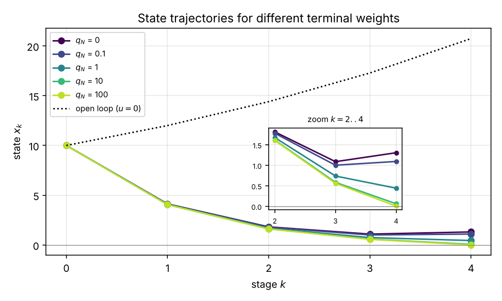

# Exercise 2 — Dynamic Programming (Finite Horizon)

Lecture: Lecture 2 — Dynamic Programming (script Chapter 2). Problem sheet: Exercise 2 of the course (keep a local copy in [`../course-material/`](../course-material/); it is not published here).

## Files

| File | What it contains |
|---|---|
| [`01_Concepts.md`](01_Concepts.md) · [PDF](pdf/01_Concepts.pdf) | Optimisation and probability toolkit, sequential decisions, open vs closed loop, the stochastic DP problem, Bellman's principle, the DP algorithm with full optimality proof, complexity, the lecture examples (pre-heating, scheduling, chess, inventory), cost design and state augmentation, scalar LQ DP, discounting, tabular DP, monotonicity, infinite-horizon outlook |
| [`02_Solutions.md`](02_Solutions.md) · [PDF](pdf/02_Solutions.pdf) | Tasks 1–4, the numerical experiment and the additional task ⋆, fully worked |
| [`python/lecture_examples.py`](python/lecture_examples.py) | Lecture examples: pre-heating sweep (inputs double each step), scheduling ($C\to A\to B\to D$, cost 9), chess match |
| [`python/task1_state_augmentation.py`](python/task1_state_augmentation.py) | Task 1: slew-rate penalty via augmented state (DP = brute force), barrier vs soft penalty, disturbance causality |
| [`python/task2_scalar_lq_dp.py`](python/task2_scalar_lq_dp.py) | Task 2: symbolic induction step, DP vs brute force, certainty equivalence (symbolic + Monte Carlo) |
| [`python/task3_discounted_dp.py`](python/task3_discounted_dp.py) | Task 3: $V_k = \alpha^{-k}J_k$, same policy, steps-to-go property, value-iteration contraction |
| [`python/task4_ev_charging.py`](python/task4_ev_charging.py) | Task 4: DP tables and brute-force check |
| [`python/numerical_experiment.py`](python/numerical_experiment.py) | Numerical experiment: $p_k$, gains, trajectories for $q_N\in\lbrace0,0.1,1,10,100\rbrace$ → [`python/figures/`](python/figures/) |
| [`python/additional_monotonicity.py`](python/additional_monotonicity.py) | Additional task: $J_0\le J_1\le\dots\le J_N$ on random problems |

Run any script with `python python/<name>.py` (needs `numpy scipy matplotlib sympy`).

## Progress

- [x] Lecture 2 concepts
- [x] Task 1 — Designing cost functions & state augmentation
- [x] Task 2 — Scalar linear-quadratic DP (deterministic & stochastic)
- [x] Task 3 — Finite-horizon discounted cost
- [x] Task 4 — Tabular DP with hard constraints (EV charging)
- [x] Numerical experiment — effect of terminal costs
- [x] Additional task ⋆ — monotonicity of DP

## Key results

- **DP algorithm:** $J_N = g_N$, $J_k(x) = \min_{u\in U_k(x)}\mathbb{E}[g_k(x,u,W_k) + J_{k+1}(f_k(x,u,W_k))]$; cost linear in $N$, exponential in $n+m$.
- **Task 2:** $J_k = p_kx_k^2$, $p_4 = q_N$, $p_k = 1 + \frac{a^2p_{k+1}}{1 + b^2p_{k+1}}$, $u_k = -\frac{abp_{k+1}}{1 + b^2p_{k+1}}x_k$. $q_N = 0\Rightarrow u_3 = 0$. With noise: $J_k = p_kx_k^2 + c_k$, $c_k = c_{k+1} + p_{k+1}\sigma^2$, same gains (certainty equivalence).
- **Task 3:** $V_N = g_N$, $V_k = \min\mathbb{E}[g_k + \alpha V_{k+1}(f_k)]$ — one time-invariant Bellman operator.
- **Task 4:** $J_0(0) = 8$, charge at night; at $x_1 = 1$ charging in the peak is a tie, so $(1,0)$ and $(1,1)$ are both optimal.
- **Numerical experiment:** $x_4 = \frac{a}{1 + b^2q_N}x_3$: without terminal cost the unstable plant drifts at the end; large $q_N$ gives deadbeat ($L_3\to a/b$). Early gains hardly change.
- **Additional task:** monotone $T$ + time invariance ⇒ $J_0\le J_1\le\dots\le J_N$.

