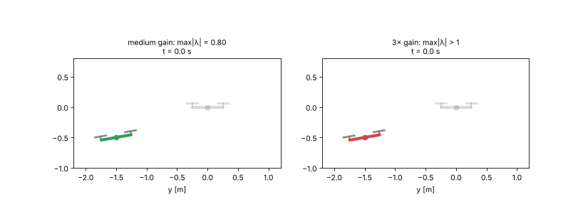

# Optimisation Based Control

Study notes, step-by-step solutions and Python code for the course
**Optimization-Based Control Methods** (TU Chemnitz, Automatic Control Group, Dr. Adrian Redder).

The notes are written for someone learning control theory from scratch: every concept is derived, and no solution steps are skipped.

## Repository layout

```
Optimisation-Based-Control/
├── README.md                          ← you are here
├── course-material/                   ← put your local copies of the course PDFs here (not published)
├── Exercise-01_Linear-Systems-and-Controllers/
│   ├── README.md                      ← overview and progress of this exercise
│   ├── 01_Concepts.md                 ← theory, in depth, with derivations
│   ├── 02_Solutions.md                ← step-by-step solutions
│   ├── 03_Lab.md                      ← hands-on lab: drone + robot arm, plots and animations
│   ├── pdf/                           ← PDF versions of the three notes
│   ├── python/                        ← scripts that verify every result
│   └── lab/                           ← lab experiments (exp1 … exp6) and their figures/GIFs
└── tools/
    └── build_pdfs.sh                  ← regenerate the PDFs from the Markdown
```

## Exercises

| # | Topic | Concepts | Solutions | Lab | Code | Status |
|---|---|---|---|---|---|---|
| 1 | Linear systems and linear controllers | [md](Exercise-01_Linear-Systems-and-Controllers/01_Concepts.md) · [pdf](Exercise-01_Linear-Systems-and-Controllers/pdf/01_Concepts.pdf) | [md](Exercise-01_Linear-Systems-and-Controllers/02_Solutions.md) · [pdf](Exercise-01_Linear-Systems-and-Controllers/pdf/02_Solutions.pdf) | [md](Exercise-01_Linear-Systems-and-Controllers/03_Lab.md) · [pdf](Exercise-01_Linear-Systems-and-Controllers/pdf/03_Lab.pdf) | [python](Exercise-01_Linear-Systems-and-Controllers/python) | Task 0 ✅ · Task 1 ✅ · Task 2 ⏳ · Task 3 ⏳ · Numerical experiment ⏳ |

## How to use

1. Read the **Concepts** file for an exercise first. It builds up everything you need (linear algebra → eigenvalues → systems → the topic of the exercise).
2. Work through the **Lab**: the same concepts on a simulated drone and robot arm, with plots and animations you can modify.
3. Try the task yourself, then compare with the **Solutions** file.
4. Run the **Python** scripts to check the numbers:
   ```bash
   pip install numpy scipy matplotlib pillow
   python Exercise-01_Linear-Systems-and-Controllers/python/task0_reachability_observability.py
   python Exercise-01_Linear-Systems-and-Controllers/lab/run_all.py
   ```



The Markdown files use LaTeX math, which GitHub renders directly. The PDFs can be rebuilt with `bash tools/build_pdfs.sh` (needs `pandoc` and `xelatex`).
